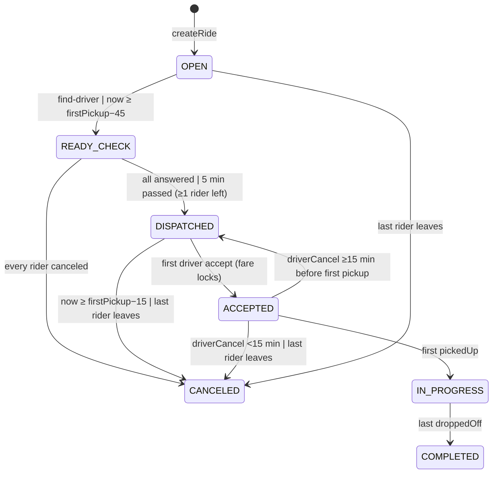
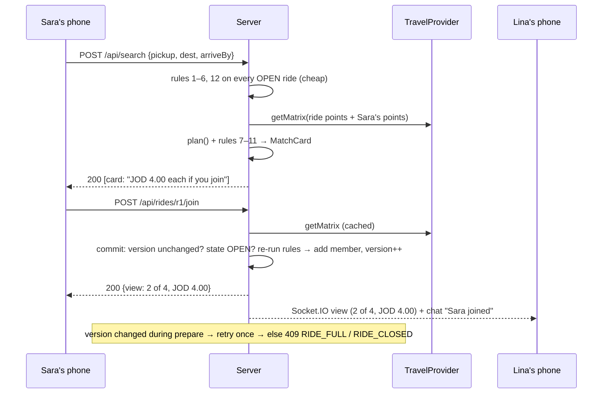

# ARCHITECTURE.md: Jeeny Shared Ride

> How the app is built. **What** it does is in `docs/SPEC.md` (v4), which wins on any
> product conflict. **How it looks** is in `docs/DESIGN.md`.
> Every session reads `AGENTS.md`, `STATUS.md` and **§1 Locked Decisions** below before
> touching code.
> `[verify]` = a teammate checks this before build day. It doesn't block the build.

---

## 0. Goals & Non-Goals

**Goals (hard requirements from `docs/planning/PROMPT.md`):**
1. Ride state and chat sync live across 3+ phones on one public URL.
2. One server-side clock and one server-side rules engine. Phones never decide anything.
3. Google is called only from the server. The server key never reaches a phone.
4. The demo runs from the saved snapshot, so bad venue wifi or a Google outage can't kill it.
5. It looks native to Jeeny (DESIGN.md), ships in one day, and can be redeployed after every milestone.

**Non-goals:** everything in SPEC §5 (real GPS, payments, OTP, AI, bus tracking, host
approval, late joins, chat extras, RTL, push notifications). Also: more than one server
instance, a hosted database (one SQLite file only), native app builds, and handling load beyond a few dozen phones.

---

## 1. Locked Decisions

Changing any row needs the repo owner's explicit approval, logged in `STATUS.md`.

| Decision | Choice | Why | Do Not Override |
|---|---|---|---|
| Product | Jeeny Shared Ride, as defined in `docs/SPEC.md` v4 | One flow done well beats many half-built ones | Don't add features that aren't in SPEC |
| Product form | Mobile **web** app (React SPA) on one public URL | 3 phones open a link, no install or store review | No native builds, no PWA install flow |
| Stack | **Option A:** Node 20 + TypeScript server, React (Vite) SPA, Socket.IO, Prisma + SQLite | One process = one clock, one engine, one key store. Fastest path to a public URL. Claude Code and Codex are both fluent in it | Don't add Next.js, Supabase or a second server process |
| Client | **React 18 + Vite + TypeScript**, thin client | DESIGN.md is already written in CSS (`--accent`, px, `dir="auto"`) | No business logic in the browser: no fare math, matching or state transitions |
| Shared types | `shared/` workspace package: view types, request bodies (zod), error codes | Server and client compile against the same types, so the protocol can't drift | Change a protocol type only in `shared/` |
| Server | **TypeScript on Node 20**, a single process, **Fastify** (REST + serving the built SPA) | One clock, one rules engine, one source of truth | Don't split into microservices or serverless functions |
| Commands | **REST**: one `POST /api/...` per user action. The HTTP response is the result (`200` + the caller's fresh view, or `409` + an error code) | Plain `fetch`. Each endpoint can be tested with curl | Don't send commands over Socket.IO |
| Real-time | **Socket.IO**, attached to the Fastify server on the same port. **Server → phone only**. Rooms: `user:<id>`, `ride:<id>` (group chat), `dm:<rideId>:<riderId>` (driver channel). **Full per-user view pushes** | Built-in reconnect, ping/pong and polling fallback over flaky mobile data | Don't send deltas or patches. Don't rely on Socket.IO's replay for catch-up: the full view on connect *is* the catch-up |
| Data store | **SQLite via Prisma** (`data/app.db`). Schema stays Postgres-portable. All writes go through one lock (§7.2) | Zero setup, survives a restart, portable if Jeeny wants it later | No hosted database for the demo. No raw SQL outside `store/` |
| Clock | One server-side **demo clock**. Every rule reads `clock.now()` | Fast-forward has to move everyone at once | Never use `Date.now()` / `new Date()` in domain code or in the browser for business times |
| Rules engine | Pure TS functions in `server/src/engine/`, ported from `docs/reference/fare_model.py` | Testable against the §4.7 golden values | Don't import or run the Python. Don't "improve" the formulas |
| Travel data | `TravelProvider` interface with three sources: Google / Snapshot / Fixed table (§5) | The demo must survive bad wifi | No Google route or matrix calls from the browser |
| Demo data source | **Snapshot** (`data/demo_snapshot.json`) | No network calls on stage | Don't switch to Live Google for the pitch |
| Auth | Name + gender signup → random token in `localStorage`. No OTP | SPEC §2.4: mocked | Gender can't be changed after signup |
| Money | Engine computes in floats, rounding exactly where the reference does. Stored balances and shares are **integer piastres** (1 JOD = 100) | Golden values match, and sums like 3 × 2.20 + 2.30 stay exact | No currency floats in stored state |
| Payment | Cash shown, nothing charged | SPEC §5 | No payment SDKs |
| UI language | English, LTR only | SPEC §5 | No RTL, no Arabic UI strings |
| Hosting | **Replit, hosting only.** Repl imported from GitHub, deployed as a **Reserved VM, 1 instance** | One public URL. GitHub stays the single source of truth | Nobody edits code in Replit. Don't use Autoscale: it scales to zero and can run more than one instance `[verify Replit plan]` |
| Who codes what | **Claude Code** = core logic, test-first (engine, matching, state machine, ready check, money flow, chat masking, real-time). **Codex** = UI, layout and glue (screens from DESIGN.md, components, demo menu, wiring) | Matches PROMPT.md skill routing. Core logic gets TDD, UI gets fast edits | One tool edits the repo at a time. Both read `AGENTS.md`, overwrite `STATUS.md` and commit before switching |
| Design | `docs/DESIGN.md` tokens → `web/src/styles/tokens.css` as CSS variables. `data-role="rider"` → pink accent, `data-role="driver"` → purple | Must look native to Jeeny. One `--accent` token, as DESIGN.md requires | No component library (MUI, Chakra, …) and no hard-coded pink or purple in components |

---

## 2. System Overview

```
 Phone A (Lina)   Phone B (Sara)   Phone C (Omar, driver)   Laptop (demo menu)
      │                │                   │                       │
      └──────── React SPA (same URL, same build, served by Fastify) ┘
                         │ HTTPS POST /api/*   ▲ Socket.IO /socket.io (server → phone)
                         ▼ (commands)          │
 ┌──────────────────────── Node 20 · TypeScript · one process ────────────────────────┐
 │  http/      Fastify routes: every command, places proxy, static SPA (server/public)│
 │  realtime/  Socket.IO: auth on connect → rooms → push per-user views, chat, search │
 │  commands/  one handler per user action (create, join, leave, chat, accept, ...)   │
 │  domain/    ride state machine, ready check, dispatch, money flow, chat masking    │
 │  engine/    PURE: tariff, fare, stop-order plan, matching rules 1–12, leave math   │
 │  travel/    TravelProvider → Google | Snapshot | Fixed (+ cache + auto fallback)   │
 │  clock/     demo clock + scheduler tick (1 s)                                      │
 │  store/     Prisma repo + global write lock · seed · reset                         │
 │  views/     projections: what each user may see (privacy is enforced here)         │
 └──────────────────────────────┬─────────────────────────────────────────────────────┘
          SQLite file (data/app.db)   │ server key only (.env / Replit Secrets)
                                      ▼
             Google Routes API (matrix + route) · Places API (autocomplete)
             — not called in demo mode; Snapshot file used instead —
```

**Golden rule:** phones send *intents* and render *views*. The server decides everything.

---

## 3. Repository Layout

npm workspaces: `shared`, `server`, `web`.

```
/
├─ AGENTS.md            master instructions
├─ CLAUDE.md -> AGENTS.md   symlink so Claude Code loads it (Codex reads AGENTS.md directly)
├─ STATUS.md            overwritten on every handoff
├─ package.json         workspaces + root scripts (check, test, build, start, snapshot)
├─ .env.example         variable names only
├─ docs/                SPEC.md · DESIGN.md · ARCHITECTURE.md · reference/fare_model.py
├─ data/
│  ├─ seed.json         places (place_id, name, lat/lng, key, area), users, driver Omar
│  ├─ demo_snapshot.json  generated once by server/scripts/make-snapshot.ts, committed
│  └─ app.db            SQLite, runtime only, git-ignored
├─ shared/              @nextstop/shared (TypeScript, no runtime deps except zod)
│  └─ src/              views.ts (RiderView, DriverView, MatchCard), requests.ts (zod bodies),
│                       errors.ts (codes + messages), events.ts (Socket.IO event map)
├─ server/              Node 20 + TypeScript (strict)
│  ├─ prisma/schema.prisma
│  ├─ src/
│  │  ├─ index.ts       boot: Prisma, seed-if-empty, clock, Fastify, Socket.IO
│  │  ├─ config.ts      env parsing (zod)
│  │  ├─ clock/         clock.ts, scheduler.ts
│  │  ├─ engine/        tariff.ts, geo.ts, fare.ts, plan.ts, matching.ts, leave.ts, constants.ts
│  │  ├─ travel/        provider.ts (interface), google.ts, snapshot.ts, fixed.ts, cached.ts, select.ts
│  │  ├─ domain/        types.ts, rideMachine.ts, readyCheck.ts, dispatch.ts, money.ts, chat.ts, events.ts
│  │  ├─ commands/      one file per command (prepare + commit)
│  │  ├─ views/         riderView.ts, driverView.ts, searchView.ts, demoView.ts
│  │  ├─ realtime/      io.ts (auth middleware, rooms, push helpers, live searches)
│  │  ├─ http/          routes.ts (§7.1 table), auth.ts (Bearer token), errors.ts
│  │  ├─ store/         repo.ts (interface), prismaRepo.ts, memoryRepo.ts (tests), lock.ts, seed.ts
│  │  └─ sim/           simRiders.ts (simulated riders and their chat lines)
│  ├─ test/             golden.test.ts, matching.test.ts, machine.test.ts, demo-script.test.ts, mask.test.ts, views.test.ts
│  ├─ scripts/make-snapshot.ts
│  └─ public/           Vite build output (generated by the build, git-ignored)
└─ web/                 React 18 + Vite + TypeScript
   ├─ index.html        viewport-fit=cover, theme-color
   └─ src/
      ├─ main.tsx, router.tsx (React Router)
      ├─ styles/        tokens.css (DESIGN.md variables), base.css
      ├─ net/           api.ts (fetch + Bearer), socket.ts (socket.io-client + reconnect)
      ├─ state/         session.ts (Zustand store: latest view, connection state)
      ├─ screens/       Signup, HomeMap, Search, SharedSetup, Matches, Status, Chat,
      │                 DriverHome, DriverOffer, DriverTrip, DemoMenu
      └─ components/    SeatRow, MatchingCard, ReadyCheckSheet, LateCancelSheet, BottomSheet, …
                        (one .tsx + one .module.css each)
```

---

## 4. Data Model (domain types in `server/src/domain/types.ts`)

All times are **demo-clock** ISO strings (`Asia/Amman`, UTC+3). Money is integer
**piastres** (`p`) unless the name ends in `Jod`.

```ts
type Gender = 'F' | 'M';
type Role = 'rider' | 'driver';

interface Place { key?: string; placeId?: string; name: string; area: string; lat: number; lng: number }
// `area` = coarse label shown to non-members ("City Center area"), SPEC §3.5 card.

interface User {
  id: string; token: string; epoch: number;        // epoch bumps on reset → logs everyone out
  role: Role; firstName: string; gender: Gender;   // gender immutable after signup
  outstandingP: number;                            // late-cancel/no-show debt shown on next booking
  isSim?: boolean;                                 // simulated rider (no socket)
}

interface Driver {                                 // role === 'driver'
  userId: string; car: string; plate: string; base: Place;
  creditBalanceP: number;                          // Jeeny credits from late leaves/no-shows
  rejectedRideIds: string[];
}

type RideState = 'OPEN' | 'READY_CHECK' | 'DISPATCHED' | 'ACCEPTED' | 'IN_PROGRESS' | 'COMPLETED' | 'CANCELED';
type MemberState = 'JOINED' | 'READY' | 'PICKED_UP' | 'DROPPED_OFF' | 'LEFT' | 'NO_SHOW';

interface Member {
  userId: string; pickup: Place; dest: Place; arriveBy: string;
  joinedAt: string; state: MemberState;
  firstShownPickup: string;      // rule 9 baseline
  shownPickup: string;           // current "Be ready by" (drives >3 min banners)
  soloFareP: number; soloInCarMin: number;  // rule 8 and 10 baselines
  readyAnswer?: 'READY' | 'CANCEL';
  leave?: { at: string; late: boolean; chargedP: number };
}

interface Stop { id: string; kind: 'P' | 'D'; userId: string; place: Place; at: string; done: boolean }
// id = `${kind}-${userId}`: stable across leaves, used in driver stop URLs.

interface Plan {                 // output of engine/plan.ts
  stops: Stop[]; firstPickup: string; km: number; durMin: number;
  fareJod: number;               // full fare, 2-dp, from the engine
  shareP: number;                // ceil to 5 piastres
  inCarMin: Record<string, number>;
}

interface Ride {
  id: string; version: number;   // bumps on every mutation (optimistic re-check, §7.2)
  state: RideState; hostUserId: string;          // host passes to earliest remaining joiner
  gender: Gender;
  anchor: { pickup: Place; dest: Place; arriveBy: string; route: LatLng[] };
  members: Member[];             // includes LEFT/NO_SHOW for history
  plan: Plan;                    // current plan for active members
  frozen?: { at: string };       // set at READY_CHECK: pickup times frozen
  locked?: { at: string; matrix: Matrix; tariff: 'DAY' | 'NIGHT' };  // set at ACCEPTED
  creditsP: number;              // sum of late-leave / no-show charges
  readyCheck?: { startedAt: string; endsAt: string; startedBy: 'host' | 'auto' };
  dispatch?: { at: string; expiresAt: string; offeredTo: string[] };
  driverUserId?: string;
  createdAt: string; closedAt?: string;          // chat deleted closedAt + 24 h
}

interface ChatMessage {
  id: string; rideId: string; seq: number;       // seq is per channel, monotonic
  channel: 'group' | `driver:${string}`;         // driver:<riderUserId> = one-to-one
  kind: 'user' | 'system'; fromUserId?: string;
  text: string;                                  // already masked (SPEC §3.11)
  at: string;
}

interface Banner { id: string; userId: string; text: string; tone: 'info' | 'warn' | 'danger'; at: string; seen: boolean }

interface DemoSettings {
  source: 'snapshot' | 'google' | 'fixed'; offlineFallbackActive: boolean;
  traffic: 'normal' | 'heavy' | 'jam'; weather: 'clear' | 'rain';
  driversNearby: 2 | 8 | 20; simAutoReady: boolean;
}
```

### 4.1 Storage (`server/prisma/schema.prisma`)

The domain types above are what the code works with. `store/prismaRepo.ts` maps them
to and from these tables. Nested objects (places, plan, matrix, anchor route) are stored as
**JSON in `String` columns**, and enum-like values as `String`. That works on SQLite with any
Prisma version and ports to Postgres unchanged.

```prisma
datasource db {
  provider = "sqlite"
  url      = env("DATABASE_URL")
}

generator client {
  provider = "prisma-client-js"
}

model User {
  id           String   @id
  token        String   @unique
  epoch        Int
  role         String   // 'rider' | 'driver'
  firstName    String
  gender       String   // 'F' | 'M', never updated
  outstandingP Int      @default(0)
  isSim        Boolean  @default(false)
  createdAt    String
  driver       Driver?
  memberships  Member[]
}

model Driver {
  userId          String @id
  user            User   @relation(fields: [userId], references: [id])
  car             String
  plate           String
  baseJson        String
  creditBalanceP  Int    @default(0)
  rejectedRideIds String @default("[]")   // JSON string[]
}

model Ride {
  id             String  @id
  version        Int     @default(0)
  state          String
  hostUserId     String
  gender         String
  anchorJson     String               // { pickup, dest, arriveBy, route }
  planJson       String               // Plan, including stops
  frozenAt       String?
  lockedJson     String?              // { at, matrix, tariff }
  creditsP       Int     @default(0)
  readyCheckJson String?
  dispatchJson   String?
  driverUserId   String?
  createdAt      String
  closedAt       String?
  members        Member[]
  messages       ChatMessage[]
  @@index([state])
}

model Member {
  rideId           String
  userId           String
  ride             Ride   @relation(fields: [rideId], references: [id], onDelete: Cascade)
  user             User   @relation(fields: [userId], references: [id])
  pickupJson       String
  destJson         String
  arriveBy         String
  joinedAt         String
  state            String
  firstShownPickup String
  shownPickup      String
  soloFareP        Int
  soloInCarMin     Float
  readyAnswer      String?
  leaveJson        String?
  @@id([rideId, userId])
}

model ChatMessage {
  id         String  @id
  rideId     String
  ride       Ride    @relation(fields: [rideId], references: [id], onDelete: Cascade)
  seq        Int
  channel    String  // 'group' | 'driver:<riderUserId>'
  kind       String  // 'user' | 'system'
  fromUserId String?
  text       String  // already masked
  at         String
  @@index([rideId, channel, seq])
}

model Banner {
  id     String  @id
  userId String
  text   String
  tone   String
  at     String
  seen   Boolean @default(false)
  @@index([userId, seen])
}

model DemoState {            // exactly one row, id = 1
  id           Int    @id @default(1)
  epoch        Int
  demoNowIso   String // saved every tick; on boot the clock resumes from here
  settingsJson String // DemoSettings
}
```

**Invariants (asserted in tests):**
- At most 4 active members. All members share `ride.gender`.
- A user has at most one active ride in any ±15 min window (rule 12).
- After `frozen`, member pickup `at` values never change. Removing a member only removes their stops.
- After `locked`, fare re-evaluation uses `locked.matrix` and `locked.tariff`, never new travel data.
- `driver cash to collect + creditsP ≥ new full fare` after any leave (SPEC §3.10).

---

## 5. TravelProvider

The engine never knows where distances come from.

```ts
// server/src/travel/provider.ts
interface LatLng { lat: number; lng: number }
interface Cell { km: number; minTraffic: number; minFree: number }
type Matrix = { points: LatLng[]; cells: Cell[][] };      // cells[i][j] = i → j

interface TravelProvider {
  readonly name: 'google' | 'snapshot' | 'fixed';
  getMatrix(points: LatLng[], departure: Date): Promise<Matrix>;   // ≤ 8 points
  getRoute(a: LatLng, b: LatLng, departure: Date): Promise<LatLng[]>;
}
```

| Source | Used for | How |
|---|---|---|
| **Fixed** (`fixed.ts`) | Unit tests, automatic fallback | Port of `fare_model.py` `leg_km` / `leg_min` / `anchor_route`: haversine × circuity (urban 1.35, highway 1.15), via the exit node (32.5200, 35.8900) for legs to or from JUST, traffic curve SPEC §4.3. **Generalize** "is JUST" to "within 1 km of JUST" so non-seed points work. `minTraffic` depends on the leg's start time, so Fixed exposes a `legMin(a, b, t)` hook (below) |
| **Snapshot** (`snapshot.ts`) | Demo (default) | Reads `data/demo_snapshot.json` once at boot. Key = `(placeKeyA, placeKeyB, 15-min bucket)`. Unknown point → Fixed for that cell, plus a `console.warn` |
| **Google** (`google.ts`) | P1/P2 live mode, snapshot generation | Routes API `computeRouteMatrix` (one call per ride evaluation) and `computeRoutes` (anchor route, map line). Traffic-aware, using `duration` → `minTraffic` and `staticDuration` → `minFree` `[verify field names]`. Departure = demo time mapped to the **next real date with the same weekday and time** |

**Wrappers (`cached.ts`, `select.ts`):**
- Cache key = points rounded to 4 dp + 15-min bucket. In memory only.
- `select.ts` returns the provider chosen by `demo.source`. A Google error or a call over 2.5 s
  → that evaluation uses Fixed and sets `offlineFallbackActive` (shown only in the demo menu).
- Demo multipliers (P2): Fixed multiplies the congestion factors. Google and Snapshot
  multiply `(minTraffic − minFree)`.

**Time dependency.** In the reference model, leg time depends on the *leg's start
time* (Fixed curve), and `latest_start` iterates. To keep one code path:

```ts
interface TimedMatrix { km(i: number, j: number): number; legMin(i: number, j: number, t: Date): number; freeMin(i: number, j: number): number }
```

- Fixed: `legMin` evaluates the traffic curve at `t` (exact port, so the golden values hold).
- Snapshot/Google: `legMin` returns the cell for the bucket that contains the ride's
  departure (SPEC §4.2.1: one departure time per ride).

**Snapshot generation** (`npm run snapshot`, needs the server key): all ordered pairs of
seed places × buckets Sun 06:00–08:30, plus the CC → JUST anchor route. Then rerun
the engine with the snapshot and paste the regenerated numbers into SPEC §2.2/§2.3/§1/§6.
Commit the JSON.

---

## 6. Rules Engine (`server/src/engine/`, pure, no I/O)

| File | Port of | Notes |
|---|---|---|
| `constants.ts` | top of `fare_model.py` | Single place for every number in SPEC §3.5, §3.10, §4 |
| `tariff.ts` | `DAY`, `NIGHT`, `tariff()`, `up05()` | Tariff picked by **first pickup** time. `CALIBRATION` from env, default 1.00 |
| `geo.ts` | `hav`, `dist_point_segment_km`, `dist_point_polyline_km` | Used by rules 5 and 6 |
| `fare.ts` | `evaluate()` | Billed wait = Σ(traffic − free) + dwell (1.5 min pickup, 0.5 min drop-off) |
| `plan.ts` | `latest_start()`, `plan()` | Enumerate **only precedence-valid orders** (4 riders → 2,520, not 40,320). Same score: `fare×100 + dur + 0.01×Σ inCar` |
| `matching.ts` | `check_join()` + rules 3, 11, 12 | Run cheap rules 1–6 first, then plan. Returns `{ok, reason, plan, shareP}` |
| `leave.ts` | `leave()` | Frozen order and T0. Late leave: `min(old, up05((fare − credit)/n))` |

**Porting traps (read before writing a line):**
1. **Rounding must match Python exactly.** `leg_km` rounds the urban and highway parts
   separately to 0.1 km. `evaluate` rounds km to 0.1 and fare to 0.01. `up05` is
   `ceil(round(x*100, 6) / 5) * 5 / 100`. Write a `pyRound(x, d)` helper with
   half-to-even rounding and use it everywhere the Python uses `round`.
2. JS `Date` is mutable and its months start at 0. Use `date-fns` (or epoch ms) and one `addMinutes` helper.
3. Weekday: Python `weekday()` has Mon = 0, so Fri/Sat = 4, 5. JS `getDay()` has Sun = 0, so Fri/Sat = 5, 6.
4. Effective arrive-by = earliest member arrive-by. Deadline = that − 5 min.

**Golden tests** (`test/golden.test.ts`, tolerance ±0.01 JD / ±1 min, Fixed source,
CALIBRATION 1.00). They must match the values **`fare_model.py` actually prints**:

| Case | Expected |
|---|---|
| Solo CC → JUST Sun, arrive 03:00 / 07:30 / 08:00 / 11:00 / 15:00 / 22:00 | pickup 02:28 / 06:48 / 07:15 / 10:21 / 14:17 / 21:26 · fare 8.26 / 7.60 / 7.81 / 7.43 / 7.70 / 7.16 · rounded 8.30 / 7.60 / 7.85 / 7.45 / 7.70 / 7.20 |
| Solo per rider (fixture) | Lina 7.85 · Sara 6.90 · Rania 7.10 · Dana 6.70 · Noor 6.05 |
| 4-rider fixture (Rania 8:15) | Normal 07:02 · 54 min · 9.03 · 2.30 · 21.4 km. Heavy 06:54 · 9.49 · 2.40. Jam 06:42 · 10.12 · 2.55. Rain 06:56 · 9.38 · 2.35 |
| Rule 5 distances | HS 0.8 · US 0.3 · YU 1.0 · AM 0.9 km |
| v4 demo joins | 7.81/7.85 → 7.95/4.00 → 8.67/2.90 → 9.03/2.30. Host estimates 7.85 · 4.15 · 2.95 · 2.35 |
| Sara late leave at 06:35 | new fare **8.86**, each 2.20, credit 2.30, remainder 0.04. Free leave at 06:20: each 3.00 |

> **Spec/model mismatches found while writing this doc. Fix SPEC.md, not the engine:**
> - SPEC §2.3/§4.7 say the 3-rider fare after Sara leaves is **8.88** with remainder 0.02. The model prints **8.86** and **0.04**.
> - SPEC §4.7 Rain trip says **60 min**. The model prints **59** (within ±1 min).
> - SPEC §4.7 "Same times, Friday" (7:09 · 46 min · 8.60 · 2.15) is **not printed** by the model. Add it to `fare_model.py` or drop it from the tests.

---

## 7. Commands, Concurrency and the State Machine

### 7.1 REST commands
Every user action is one `POST`. Auth is the header `Authorization: Bearer <token>`.
Bodies are JSON, validated with zod. The **caller** gets the result in the HTTP response.
**Everyone else** affected gets a Socket.IO `view` push (§9).

| Endpoint | Who | Body | Notes |
|---|---|---|---|
| `POST /api/signup` | anyone | `{firstName, gender, role}` | No auth. Returns `{token, epoch, view}` |
| `GET /api/me` | any | — | Returns the current view (first load, and after reconnect if wanted) |
| `GET /api/places?q=` | rider | — | P1 autocomplete proxy (country `jo`, biased to Irbid) |
| `POST /api/quote` | rider | `{pickup, dest, arriveBy}` | Solo fare, host estimates for 1–4 riders, "Be ready by" |
| `POST /api/rides` | rider | `{pickup, dest, arriveBy}` | Create a ride (become host) |
| `POST /api/search` | rider | `{pickup, dest, arriveBy}` | Returns `MatchCard[]` and keeps this search **live for 60 s**: matching changes are pushed as `search` messages. Call again to extend |
| `POST /api/rides/:id/join` | rider | `{pickup, dest, arriveBy}` | Auto-join. Re-runs every rule at commit |
| `POST /api/rides/:id/leave` | rider | `{acceptCharge?: boolean}` | If the server decides at commit time that this is a **late** leave and `acceptCharge` isn't `true` → `409 LATE_CONFIRM_REQUIRED {chargeJod}`. The client shows the late-cancel sheet, then repeats with `acceptCharge: true` |
| `POST /api/rides/:id/find-driver` | host | — | Starts the ready check |
| `POST /api/rides/:id/ready` | rider | `{answer: 'READY' \| 'CANCEL'}` | `CANCEL` = free leave |
| `POST /api/rides/:id/chat` | member, driver | `{channel, text}` | Masked before storing (§9.4) |
| `POST /api/banners/:id/seen` | any | — | |
| `POST /api/offers/:rideId/accept` | driver | — | First commit wins. A loser gets `409 OFFER_TAKEN` |
| `POST /api/offers/:rideId/reject` | driver | — | That driver never gets this ride again |
| `POST /api/rides/:id/driver-cancel` | driver | — | §7.3 |
| `POST /api/rides/:id/stops/:stopId/{picked-up,dropped-off,no-show}` | driver | — | `no-show` only ≥ 5 min after the pickup time |
| `POST /api/demo/clock` | demo | `{advanceMin} \| {jumpTo} \| {next: true}` | Header `X-Demo-Pin`. Stepped fast-forward (§8) |
| `POST /api/demo/simulate-rider` | demo | `{rideId}` | |
| `POST /api/demo/reset` | demo | — | |
| `POST /api/demo/settings` | demo | `Partial<DemoSettings>` | |

**Responses:**
- `200 {ok: true, view}`: success, with the caller's fresh view, so the caller never waits for the socket.
- `401 {code: 'LOGGED_OUT'}`: bad token or old epoch. The client clears the token and goes to signup.
- `409 {code, message}`: a domain conflict. The `message` is the user-facing text from SPEC §3.13:

| Code | Message |
|---|---|
| `RIDE_FULL` | This ride just filled up |
| `RIDE_CLOSED` | This ride just closed |
| `RIDE_GONE` | This ride is no longer available |
| `NOT_ELIGIBLE` | (the failing rule, e.g. "Your share would be higher than riding solo") |
| `TOO_SOON` | Too soon for a shared ride. Book Economy instead. |
| `ALREADY_IN_RIDE` | You already have a ride at this time |
| `OFFER_TAKEN` | Another driver accepted this ride |
| `LATE_CONFIRM_REQUIRED` | (no message: the client shows the late-cancel sheet with `chargeJod`) |
| `ILLEGAL_STATE` | (developer error, shown as a generic toast) |

- `422 {code: 'INVALID', issues}`: the body failed validation.

**Double taps:** the client disables the button while a request is in flight. The server
also makes repeats harmless: joining a ride you're already in, or answering READY twice,
returns `200` with no change.

### 7.2 One queue, serial commits
Node runs one thread, but command handlers `await` the TravelProvider. So:

1. **Prepare (async):** load inputs, fetch the matrix for (current points + new points).
2. **Commit (inside `store.withLock(fn)`):** one global async mutex (`store/lock.ts`)
   wraps one `prisma.$transaction`. Inside it: re-read the ride, check `ride.version ===
   preparedVersion` and the state is still valid, re-run the **pure** checks, write, set
   `version++`, and collect domain events. **No network calls inside the lock.** If the version
   changed, release, retry prepare once, then fail with the SPEC §3.13 message ("This ride
   just filled up" / "This ride just closed").
3. **Publish (after the lock is released):** recompute views for affected users, return the
   caller's view in the HTTP response, and push views to everyone else over Socket.IO.

Because every write in the process goes through the same lock, commits are strictly serial
(SQLite has a single writer anyway), and "first commit wins" comes for free. The scheduler's
tick takes the same lock, so a ready check starting and a join arriving at the same moment are
serialized. The ready check wins because the join's commit sees `state !== 'OPEN'`.
Throughput doesn't matter here: a commit takes milliseconds and the demo has a handful of users.

### 7.3 Ride state machine (`domain/rideMachine.ts`)



- One function `transition(ride, event, now): Effect[]`. It throws on illegal
  transitions. Tests cover **every row** of SPEC §3.3.
- Effects are data (`SystemMessage`, `Banner`, `ChargeLeaver`, `CreditDriver`,
  `NotifyDriver`, `OfferToDrivers`), applied by `domain/events.ts`. This keeps the machine pure.
- Entering `READY_CHECK` sets `frozen`. Entering `ACCEPTED` sets `locked` (matrix + tariff).
- Entering `CANCELED` from dispatch timeout or a driver cancel adds a "Book Economy now"
  banner per member, prefilled with their solo estimate.

### 7.4 Money flow (`domain/money.ts`)
- **Free leave:** recompute the plan without the leaver (re-plan while `OPEN`; frozen order
  after `READY_CHECK`). Share = `up05(fare / n)`. If that pushes someone above their solo
  fare, give them a "you can leave free" banner and allow one free leave.
- **Late leave / no-show:** `chargedP = current shareP`, `user.outstandingP += chargedP`,
  `ride.creditsP += chargedP`, `driver.creditBalanceP += chargedP`, and the new share is
  `min(old, up05((fare − credits)/n))`.
- Leave type is decided **at commit time** from `clock.now()` vs `plan.firstPickup − 30`.

---

## 8. Clock and Scheduler (`server/src/clock/`)

```ts
now() = paused ? demoBase : demoBase + (Date.now() − realBase)   // 1× real time
advance(min)  → demoBase += min, realBase = Date.now()
jump(iso)     → set demoBase, realBase = Date.now()
```

- Default start: **Sun 29 Nov 2026 06:10** (`DEMO_START` env).
- **Scheduler tick every 1 s**, inside `store.withLock`, loads the active rides
  (`state` index), calls `dueEvents(rides, now)` (derived from state, no `setTimeout` per ride),
  applies them in time order, and saves `DemoState.demoNowIso`:
  - OPEN and `now ≥ firstPickup − 45` → auto ready check
  - READY_CHECK and `now ≥ endsAt` → missing answers count as READY → dispatch
  - DISPATCHED and `now ≥ firstPickup − 15` → cancel (no driver)
  - closed rides at `closedAt + 24 h` → delete chat
  - sim riders: answer the ready check 3 s after it starts (P1, `simAutoReady`)
- **Fast-forward is stepped:** `advance(25)` walks to each due event in order, applies
  it, then continues, so jumping 6:10 → 6:35 doesn't skip the auto ready check.
  `POST /api/demo/clock {next: true}` jumps to `min(dueEvents.at)`.
- The clock is pushed in every view (`clock.nowIso`). The client renders countdowns from
  `serverNow + (local elapsed since the message arrived)` and never from the phone's clock.

---

## 9. Real-time Sync

### 9.1 Connection and rooms
Socket.IO is attached to Fastify's HTTP server (same port, path `/socket.io`). The client
connects with `io({ auth: { token } })`. Middleware checks the token **and epoch**. If either
is bad → `next(new Error('LOGGED_OUT'))` and the client goes to signup (this is how demo
reset logs everyone out).

On connect, the server joins the socket to its rooms and emits the full `view`:

| Room | Members | Used for |
|---|---|---|
| `user:<userId>` | all of that user's sockets (several tabs are fine) | `view`, `search`, `logout`, banners |
| `ride:<rideId>` | active members of the ride | group `chat` events |
| `dm:<rideId>:<riderId>` | that rider + the accepted driver | driver-channel `chat` events |
| `drivers` | every driver socket | hint to recompute driver views when offers change |
| `all` | everyone | `clock` events, `logout` on reset |

Room membership is recomputed from the ride after every commit (join → add to `ride:`,
leave → remove, accept → add the driver to each `dm:`). **Views are still projected per user**
and sent to `user:<id>`. Rooms only decide who gets the event; `views/` decides what they see.

The socket is **push-only**: the server registers no client → server event handlers.

### 9.2 Events (server → client, typed in `shared/src/events.ts`)
| Event | When | Payload |
|---|---|---|
| `view` | On connect, and after **any** commit that touches this user (except the caller, who gets it in the HTTP response) | Full `RiderView` or `DriverView` (below), `clock`, `epoch` |
| `chat` | New message in a channel the user can see | One `ChatMessage` (for scroll animation; it's also in the next `view`) |
| `search` | While a `POST /api/search` is live (60 s), whenever an OPEN ride's matching result for this user changes (debounced 300 ms) | `MatchCard[]` |
| `clock` | Every 30 s, and right after a demo clock change | `{nowIso}` (keeps countdowns in sync) |
| `logout` | Reset (to room `all`) | — |

**Full view, not deltas.** A rider view is a few KB, so reconnect = resend. Chat in the
view = the last 100 messages per visible channel. "Reconnecting…" is shown while the
socket is down. Socket.IO handles reconnect backoff and heartbeats (`pingInterval` 10 s,
`pingTimeout` 8 s, so a dead phone is noticed fast). Don't turn on Socket.IO's connection-state
recovery: the full view on `connect` already covers catch-up.

### 9.3 Views and privacy (`server/src/views/`)
The **only** place that decides what a user sees. Tests assert each rule.

| Viewer | Sees | Never sees |
|---|---|---|
| Non-member joiner (`MatchCard`) | host first name, seat row, seats left, **area names** of pickup and destination, effective arrive-by, real recomputed share, their own pickup ~time | exact addresses, other riders' names or details |
| Member rider | members' first names and initials, their own exact pickup and destination, their own "Be ready by", share, group chat, **their own** driver channel, driver name, car and plate after accept | other members' exact addresses, other riders' driver chats |
| Driver (offered) | only rides that are `DISPATCHED`, with the final stop list (first name + short address + time), fare, collect total, km · min, respond-by | the group chat |
| Driver (accepted) | the stop list with each share, one-to-one channels, cash and credit totals | the group chat |

```ts
interface RiderView {
  me: { id; firstName; gender; outstandingJod: number };
  ride?: { id; version; state; isHost; seats: {initials; isMe}[]; seatsLeft; shareJod; soloJod;
           beReadyBy; effectiveArriveBy; myPickup; myDest; stops?: …; driver?: {name; car; plate};
           readyCheck?: {endsAt; answers: {firstName; status}[]}; findDriverAutoAt;
           lateCancelPreview?: {chargeJod} ; chat: {group: ChatMessage[]; driver?: ChatMessage[]; unread} };
  banners: Banner[]; clock: { nowIso: string };
}
```
(`DriverView` follows the same pattern. Both live in `shared/src/views.ts` and are imported by
the server **and** the client. **That file is the contract.**)

### 9.4 Chat (`domain/chat.ts`)
- Max 300 characters. Masking runs **before storing**: phone numbers (7 or more digits, with
  optional spaces or dashes between them: `/(?:\d[\s-]?){7,}/g`) and links
  (`/(https?:\/\/|www\.)\S+|\b\S+\.(com|net|org|jo|io|me|ly)\b\S*/gi`) → `•••`.
  Unit tests cover `079 123 4567`, `+962-79-1234567`, `wa.me/…`.
- System messages come from domain effects (joined, left, ready check started, X is ready,
  driver assigned, pickup time changed by more than 3 min).
- Read-only when the ride is closed. Purged 24 h after `closedAt`.

---

## 10. React Client (`web/`)

- **Thin client.** `useSession` (one Zustand store) holds the last `view` and the connection
  state. Screens are pure functions of the view. Commands go out through `net/api.ts`
  (`fetch`, Bearer token, typed with the `shared/` request bodies). A `200` replaces the
  view with the response's view. A `409` shows `message` as a banner or toast. A `401` logs out.
  `net/socket.ts` only listens: `view`, `chat`, `search`, `clock` and `logout` events update the store.
  **No optimistic UI** for joins, leaves or prices (server numbers only). Chat may show a
  pending bubble until the `POST` returns.
- **Stale views:** each view carries `ride.version`. The store ignores a pushed view that's
  older than the one it holds (an HTTP response and a socket push can arrive out of order).
- **Socket.IO client:** `io({ auth: { token } })` on the same origin. Default transports
  (polling, then upgrade to WebSocket), so it still works on networks that block WebSockets.
  On every `connect`, the server sends the full view. On `connect_error` with `LOGGED_OUT`,
  the client clears the token and goes to signup. "Reconnecting…" shows when disconnected for more than 2 s.
- **Routing (React Router):** `/signup` · `/` (map + "Where to?") · `/search` · `/shared`
  (host setup) · `/matches` · `/ride/:id` (status sheet) · `/ride/:id/chat` · `/driver` ·
  `/driver/offer/:id` · `/driver/trip/:id` · `/demo` (hidden: 5 taps on the logo, or `?demo=1`).
- **Styling:**
  - `styles/tokens.css` copies DESIGN.md's variables 1:1.
  - `<body data-role="rider|driver">` sets `--accent`, `--accent-soft` and `--accent-dark`.
  - Each component has a CSS Module. No component library, no Tailwind.
  - Fonts follow the DESIGN.md stack with its Arabic fallback. Chat bubbles use `dir="auto"`.
- **Maps:** `@vis.gl/react-google-maps`. The browser key comes from `VITE_GOOGLE_BROWSER_KEY`
  at build time (HTTP-referrer restricted, Maps JavaScript API only). P0 = pins. P1 = the
  route polyline from the view. Muted gray map style from DESIGN.md §6.
- **Places autocomplete (P1):** proxied through `GET /api/places?q=` (§7.1), so the browser
  key needs only the Maps JavaScript API. P0 uses the seed quick-pick chips.
- **Countdowns** (ready check, respond-by) use `view.clock.nowIso` plus local elapsed time since
  the last `clock`/`view` event, never the phone's wall clock.
- **Mobile web checks (Milestone 1, on real phones over mobile data):**
  - Use `100dvh` and `env(safe-area-inset-*)`.
  - The chat input stays above the keyboard on iOS Safari (use `visualViewport` if needed).
  - The bottom sheet can be dragged over the map without the page scrolling.
  - No zoom on input focus (inputs ≥ 16 px).
- **Dev loop:** `npm run dev` runs Vite (port 5173) with a proxy for `/api` and `/socket.io`
  to the server (port 3000), so the phones and the laptop use one origin in production and in dev.

---

## 11. Build, Run, Deploy

**Environment (`.env` locally, Replit Secrets in deploy, never committed):**
| Var | Example | Notes |
|---|---|---|
| `PORT` | `3000` | |
| `DATABASE_URL` | `file:../../data/app.db` | Prisma resolves SQLite paths **relative to `schema.prisma`** (`server/prisma/`) |
| `TRAVEL_SOURCE` | `snapshot` | `snapshot` / `google` / `fixed`. The demo menu can override it at runtime |
| `DEMO_START` | `2026-11-29T06:10:00+03:00` | |
| `CALIBRATION` | `1.00` | From the Jeeny Economy quote (SPEC §4.1.1) |
| `GOOGLE_SERVER_KEY` | — | Routes + Places only. **Server only** |
| `VITE_GOOGLE_BROWSER_KEY` | — | Maps JavaScript API only. Baked into the SPA at build time (it's public, protected by its referrer restriction) |
| `DEMO_PIN` | `1337` | Required by the demo endpoints |

**Root scripts (exact commands are copied into `AGENTS.md`):**
| Script | Runs |
|---|---|
| `npm run dev` | server (tsx watch) + Vite dev server, side by side |
| `npm run check:quick` | `tsc --noEmit` in all workspaces + `npm run build` |
| `npm run check` (full) | quick check + ESLint + Vitest + the key-leak grep (§15) |
| `npm run build` | `shared` (tsc) → `web` (`vite build`, output `server/public/`) → `server` (tsc) |
| `npm start` | `prisma db push --skip-generate` → `node server/dist/index.js` (seeds if the DB is empty) |
| `npm run snapshot` | `server/scripts/make-snapshot.ts` (needs `GOOGLE_SERVER_KEY`) |
| `npm run seed:reset` | wipe tables + load `data/seed.json` (same code as the demo reset) |

- `postinstall` runs `prisma generate`.
- **Pin Prisma 6.x** (`prisma` and `@prisma/client` at the same exact version). The schema above uses the
  Prisma 6 style (`url` in the datasource, `prisma-client-js`). Prisma 7 moved the connection
  config into `prisma.config.ts` and changed the client setup `[verify before upgrading]`.
- **No migrations** for the hackathon: `prisma db push` syncs the schema. If a schema change
  conflicts, delete `data/app.db`, because the seed rebuilds everything.

**Replit (hosting only):**
- Import the GitHub repo into a Repl once. Create a **Reserved VM** deployment, 1 instance.
  Build command: `npm ci && npm run build`. Run command: `npm start`.
- **Deploy loop:** push to GitHub → in the Repl's Git pane, pull → **Redeploy**.
  `[verify whether Replit can redeploy automatically on push; if not, the named driver redeploys by hand]`
- Nobody edits code in the Repl. A hotfix goes through a local tool → commit → push → pull → redeploy.
- Fastify serves `server/public/` and Socket.IO on the same origin (no CORS). Unknown
  non-API paths return `index.html` (SPA fallback).
- **SQLite on the VM:** assume `data/app.db` does **not** survive a redeploy
  `[verify]`. That's fine: boot seeds an empty DB, and reset re-seeds anyway. Never redeploy
  during the pitch.
- Redeploy after every milestone. Test on the `*.replit.app` URL over a phone hotspot.

**Fallback if Replit is down:** run the same `npm ci && npm run build` / `npm start` as one
always-on **Render or Railway** web service (single instance, Node 20). Keep it one service,
not a split frontend and backend, so there's one origin and no CORS.

---

## 12. Testing Strategy

| Layer | Tool | What |
|---|---|---|
| Engine | Vitest | §6 golden values, rounding helpers, each matching rule (pass and fail cases), leave math |
| Domain | Vitest + `memoryRepo` | every state machine row, ready check timeout, dispatch expiry, host hand-off, edge cases from SPEC §3.13 |
| Store | Vitest + a temp SQLite file | `prismaRepo` round-trips a full ride (JSON columns, piastres). Concurrent joins on the last seat: exactly one wins |
| Demo script | Vitest | replays SPEC §2.2 steps 1–6 through the REST handlers + clock jumps on the Fixed source and asserts the §6 numbers at each step |
| Views | Vitest | the privacy table in §9.3 |
| Chat | Vitest | masking cases, 300-character limit |
| Client | `tsc` (shared types) + manual run on 3 phones | No component tests unless time remains |

- Domain code depends on the `Repo` interface, not on Prisma. Tests use `memoryRepo`
  (fast, no file), and the app uses `prismaRepo`. Both must pass the same repo contract test.
- **Claude Code** works test-first (the Superpowers workflow) on `engine/`, `domain/`,
  `views/`, `chat.ts`, `store/lock.ts` and `realtime/`. **Codex** owns `web/` and the wiring in `http/`.

---

## 13. Request Flows

### 13.1 End-to-end flow
"Caller" gets the HTTP response. "Others" get a Socket.IO `view` push.

| Step | Trigger | Server action | What the phones see |
|---|---|---|---|
| Quote | Host picks Shared | `POST /api/quote`: solo plan + host estimates (SPEC §4.5) | Host: "from JOD 2.35", "If nobody joins: JOD 7.85", "Be ready by 7:15 AM" |
| Create | Host confirms | `POST /api/rides`: check first pickup is 60 min–24 h away, fetch the anchor route (1 route call), store the ride, host = member 1 | Host: status sheet, 1 of 4 seats, group chat open |
| Search | Joiner enters a trip | `POST /api/search`: rules 1–6 and 12 on every OPEN ride, then one matrix + plan + rules 7–11 for the survivors. Search stays live 60 s | Joiner: match cards (area names only, real share) or "No rides yet. Start one" |
| Join | Joiner taps Join | `POST /rides/:id/join`: prepare, then commit with a version check. Add member, re-plan, new shares, system message | Joiner: in the ride. Others: seat row + share update, "Sara joined" in chat. Live searchers: cards refresh |
| Chat | Rider sends a message | `POST /rides/:id/chat`: limit 300 chars, mask, store | All members: the message (masked) |
| Ready check | Host taps Find driver, **or** tick at first pickup − 45 | → `READY_CHECK`: joining closes, pickup times freeze, `endsAt = now + 5 min`, system message | Every member: the ready sheet with a countdown. Live searchers: the card disappears |
| Ready answer | Rider taps Ready / Cancel | `POST /rides/:id/ready`: record it. `CANCEL` = free leave + re-price | Every member: that rider's status in the sheet + chat line |
| Dispatch | All answered, **or** tick at `endsAt` (no answer = ready) | → `DISPATCHED`: offer to eligible drivers (not rejected, within 5 km of the first pickup), `expiresAt = first pickup − 15` | Riders: "Finding your driver". Drivers: the offer sheet (fare, collect, stops, respond-by) |
| Accept | Driver taps Accept | `POST /offers/:id/accept`: first commit wins → `ACCEPTED`, lock the matrix + tariff, open driver channels | Riders: "Omar · White Hyundai Elantra · 12-34567". Other drivers: the offer disappears |
| Reject | Driver taps Reject | Add to `rejectedRideIds` | That driver: the offer disappears |
| Free leave | Rider leaves before accept, or ≥ 30 min before first pickup | `POST /rides/:id/leave`: remove member and stops, re-price (`fare ÷ n`). Free-leave banner for anyone now above their solo fare | Others: new shares (usually higher). Driver (if any): new stop list |
| Late leave | Rider leaves after accept and < 30 min before first pickup | First call → `409 LATE_CONFIRM_REQUIRED`. Second call with `acceptCharge` → charge the leaver's share, credit the driver, `min(old, (fare − credits) ÷ n)` | Leaver: "Outstanding balance JOD 2.30". Others: share drops to 2.20. Driver: "Sara canceled. New total: collect JOD 6.60 + JOD 2.30 credit" |
| Driver cancel | Driver taps Cancel | ≥ 15 min before first pickup → `DISPATCHED` again. Otherwise → `CANCELED`, no fees | Riders: "Finding your driver" again, or "No driver found" + "Book Economy now" |
| Pickup | Driver taps "Picked up Lina" | Stop `done`, member `PICKED_UP`. The first pickup → `IN_PROGRESS` | Rider: "On the way". Driver: next stop |
| No-show | Driver taps No-show (≥ 5 min after pickup time) | Same money flow as a late leave | Same as a late leave |
| Drop-off | Driver taps "Dropped off · collected JOD 2.20" | Stop `done`, member `DROPPED_OFF`. The last drop-off → `COMPLETED`, `closedAt` set | Everyone: the trip summary. Chat goes read-only |
| No driver | Tick at first pickup − 15 while `DISPATCHED` | → `CANCELED`, no fees | Riders: "No driver found" + "Book Economy now" (prefilled, solo estimate) |
| Cleanup | Tick at `closedAt + 24 h` | Delete the ride's chat | — |

### 13.2 Join in detail (the race-safe path)


---

## 14. Demo Mode (`/demo`, PIN required)

- **P0:** +5 min, jump to a time, next event, simulate rider (next valid seed rider from
  `sim/simRiders.ts` in SPEC §2.6 order, joining through the **same join command handler** as
  real riders, then posting their chat line; if none is valid, the `409` explains why), reset
  (one transaction: wipe all tables, load `seed.json`, `epoch++`, reset the clock; then emit
  `logout` to room `all`).
- **P1:** sim riders auto-answer READY. Data source switch, with the "offline estimates" label.
- **P2:** traffic, weather, drivers nearby (2 / 8 / 20). Supply-aware ready check time (SPEC §4.6).

---

## 15. Security & Key Management

| Concern | Rule | Where |
|---|---|---|
| Google server key | `GOOGLE_SERVER_KEY` lives in `.env` locally and **Replit Secrets** in deploy. It's read only inside `travel/google.ts` and the places proxy. Never logged, never in any response | `config.ts`, `travel/google.ts` |
| Google browser key | `VITE_GOOGLE_BROWSER_KEY` is baked into the SPA at build time, **Maps JavaScript API only**, HTTP-referrer restricted to the `*.replit.app` domain + `localhost` | Google Cloud console, `web/` |
| Key leak check | The full check fails if the server key's value appears anywhere in `server/public/` (`grep -r "$GOOGLE_SERVER_KEY" server/public && exit 1`). The server key must never get a `VITE_` prefix: Vite only bundles `VITE_` variables | full check script |
| Google spend | Billing budget alert set before Friday. Demo runs on Snapshot (no calls). Cache by 15-min bucket | Google Cloud console |
| Auth | Random 128-bit token per signup, checked on every REST call and in the Socket.IO auth middleware, together with `epoch`. No passwords, no OTP (mocked, SPEC §2.4) | `http/auth.ts`, `realtime/io.ts` |
| Demo controls | Every `/api/demo/*` call needs `X-Demo-Pin` = `DEMO_PIN`. The demo menu isn't linked in the UI | `http/routes.ts` |
| Same-gender matching | Rule 1 runs **only on the server**, at search time **and again at commit**. Gender comes from the stored user, never from the request body. It can't be changed after signup | `engine/matching.ts`, `commands/join.ts` |
| Personal data in views | Exact addresses only go to the rider themselves and to the driver after dispatch. Everyone else sees area names and first names (§9.3) | `views/*` (tested) |
| Chat | Phone numbers and links masked **before storing**, so no view ever contains the raw text. Max 300 characters. Deleted 24 h after the ride closes | `domain/chat.ts` |
| Driver channel | One-to-one per rider. The view for rider X includes only `driver:X`, and only X and the driver are in room `dm:<ride>:X` | `views/riderView.ts`, `realtime/io.ts` |
| Input | Every body validated with zod. Times must parse, places must be inside Jordan's bounding box | `http/routes.ts` |
| Secrets in git | `.env`, `data/app.db` and `server/public/` are git-ignored. `.env.example` lists the variable names with no values | repo root |

---

## 16. Risks and Mitigations

| Risk | Mitigation |
|---|---|
| Phones drop off mobile data on stage | Socket.IO auto-reconnect + polling fallback. The full view on every `connect` restores state. Own hotspot (SPEC §2.1) |
| Replit Reserved VM restarts or redeploys mid-demo | Boot seeds an empty DB. Reset to seed in 1 tap. Never redeploy during the pitch. Backup video |
| Prisma engines or `db push` fail on Replit | Test the full deploy in Milestone 1. Pin the Prisma version. If it's blocked, fall back to Render/Railway (§11) |
| Async Prisma writes break "first commit wins" | Every commit runs inside the single global lock (§7.2), plus the version check. The store test asserts the concurrent last-seat case |
| Golden values drift in the port | Port the rounding first. Golden tests are the first tests written |
| A Google key leaks into the SPA bundle | Only `VITE_GOOGLE_BROWSER_KEY` is a `VITE_` variable. The full check greps `server/public` for the server key's value |
| iOS Safari keyboard covers the chat input | Test in Milestone 1. `visualViewport` resize handler, `100dvh` |
| plan() is slow during search with many rides | Precedence-pruned enumeration, rules 1–6 first, cache by `(ride.version, joiner inputs)` |
| Claude Code and Codex step on each other | One tool at a time. `STATUS.md` overwrite + commit before every switch. Split by folder (§12) |

