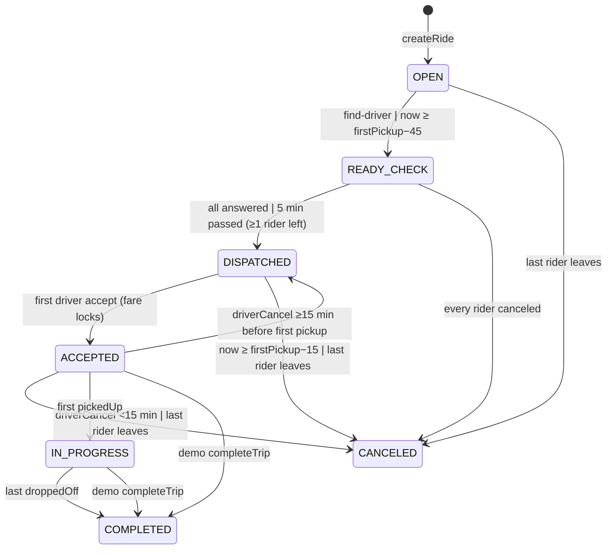
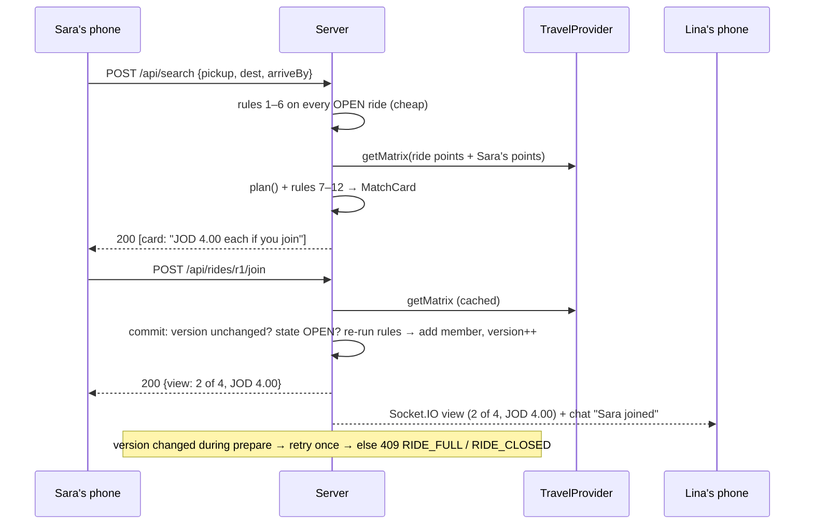

# ARCHITECTURE.md: RideSync

> How the app is built. **What** it does is in `docs/SPEC.md` (v8), which wins on any
> product conflict. **How it looks** is in `docs/DESIGN.md`.
> Every session reads `AGENTS.md`, `STATUS.md` and **§1 Locked Decisions** below before
> touching code. `docs/planning/` is history, not instructions.
> `[verify]` = a teammate checks this before build day. It doesn't block the build.
> **P0 / P1 / P2** tags follow SPEC §8. Build all P0 first.

---

## 0. Goals & Non-Goals

**Goals:**
1. Ride state and chat sync live across 3+ phones on one public URL.
2. One server-side clock and one server-side rules engine. Phones never decide anything.
3. Google routing and places are called only from the server. The server key never reaches a phone.
4. The demo uses the saved snapshot for all distances and times. The phones still need
   internet for the map and the server (own hotspot).
5. It looks like RideSync (DESIGN.md "Converge"), ships in one day, and can be redeployed after every milestone.

**Non-goals:** everything in SPEC §5. Also: more than one server instance, a hosted
database (one SQLite file only), native app builds, and load beyond a few dozen phones.

---

## 1. Locked Decisions

Changing any row needs the repo owner's explicit approval, logged in `STATUS.md`.

| Decision | Choice | Why | Do Not Override |
|---|---|---|---|
| Product | RideSync (Jeeny-powered), as defined in `docs/SPEC.md` v8 | One flow done well beats many half-built ones | Don't add features that aren't in SPEC |
| Product form | Mobile **web** app (React SPA) on one public URL | 3 phones open a link, no install or store review | No native builds, no PWA install flow |
| Stack | Node 20 + TypeScript server, React (Vite) SPA, Socket.IO, Prisma + SQLite | One process = one clock, one engine, one key store. Claude Code and Codex are both fluent in it | Don't add Next.js, Supabase or a second server process |
| Client | **React 18 + Vite + TypeScript**, thin client | DESIGN.md is written in CSS terms | No business logic in the browser: no fare math, matching or state transitions |
| Shared types | `shared/` workspace package: view types, request bodies (zod), error codes | Server and client compile against the same types | Change a protocol type only in `shared/` |
| Server | **TypeScript on Node 20**, a single process, **Fastify** (REST + serving the built SPA) | One clock, one rules engine, one source of truth | Don't split into microservices or serverless functions |
| Commands | **REST**: one `POST /api/...` per user action. The response is the result (`200` + the caller's fresh view, or `409` + an error code) | Plain `fetch`. Testable with curl | Don't send commands over Socket.IO |
| Real-time | **Socket.IO** on the same port, **server → phone only**. Full per-user view pushes | Built-in reconnect and polling fallback over flaky mobile data | No deltas or patches. The full view on connect *is* the catch-up |
| Data store | **SQLite via Prisma** (`data/app.db`). All writes go through one lock (§7.2) | Zero setup, survives a restart | No hosted database. No raw SQL outside `store/` |
| Clock | One server-side **demo clock**. Every rule reads `clock.now()`. **Paused by default in demo mode** | Fast-forward moves everyone at once. A paused clock can't break the demo while people talk | Never use `Date.now()` / `new Date()` for business times in domain code or the browser |
| Time zone | All hour, weekday and 15-min-bucket logic goes through `ammanParts()` (`Asia/Amman`). Tests run with `TZ=UTC` | Replit servers run in UTC. 6:10 AM in Amman is 3:10 AM UTC and would get night tariffs | Never call `getHours()` / `getDay()` directly on business times |
| Rules engine | Pure TS functions in `server/src/engine/`, ported from `docs/reference/fare_model.py` | Testable against what the model prints | Don't import or run the Python. Don't "improve" the formulas |
| Travel data | `TravelProvider` with three sources: Google / Snapshot / Fixed table (§5) | The demo must not depend on live Google routing | No Google route, matrix or places calls from the browser |
| Demo data source | **Snapshot** (`data/demo_snapshot.json`) | No routing calls on stage | Don't switch to Live Google for the pitch |
| Auth | Name + gender signup → random token in `localStorage`. Seeded demo logins via `/?as=…` + PIN | SPEC §2.4: mocked | Gender can't be changed after signup. The "Same gender only" toggle can |
| Money | Engine computes in floats, rounding exactly where the reference does. Stored amounts are **integer piastres** (1 JOD = 100). Late-leave credits are held **on the ride** until it completes | Golden values match. Sums stay exact. Credits follow whoever finishes the trip | No currency floats in stored state. Don't credit a driver before COMPLETED |
| Privacy | `server/src/views/` alone decides what each user sees. Riders get only their own pickup and the destination for the map | SPEC §3.14 | No other riders' coordinates in any rider view |
| Payment | Cash shown, nothing charged. Uni plan fee: demo card form, test numbers only (SPEC §3.19) | SPEC §5 | No payment SDKs. Never store or log card numbers beyond "•••• 4242" |
| UI language | English, LTR only | SPEC §5 | No RTL, no Arabic UI strings |
| Hosting | **Replit, hosting only.** Repl imported from GitHub, deployed as a **Reserved VM, 1 instance** | One public URL. GitHub stays the single source of truth | Nobody edits code in Replit. Don't use Autoscale `[verify Replit plan]` |
| Who codes what | **Claude Code** = core logic, test-first (engine, matching, state machine, ready check, money flow, chat masking, real-time, views). **Codex** = UI, layout and glue (screens, components, demo menu, HTTP wiring) | Core logic gets TDD, UI gets fast edits | One tool edits the repo at a time. Both read `AGENTS.md`, overwrite `STATUS.md` and commit before switching |
| Design | `docs/DESIGN.md` tokens → `web/src/styles/tokens.css`. `data-category` sets the accent, `data-role="driver"` switches to the dark Cockpit surfaces | RideSync has its own look, not a Jeeny mockup | No component library, no hard-coded colors in components, no pink or purple |

---

## 2. System Overview

```
 Phone A (Lina)   Phone B (Sara)   Phone C (Omar, driver)   Laptop (demo menu)
      │                │                   │                       │
      └──────── React SPA (same URL, same build, served by Fastify) ┘
                │ HTTPS POST /api/*      ▲ Socket.IO /socket.io (server → phone)
                ▼ (commands)             │          Browser also loads Google Maps JS (map tiles only)
 ┌──────────────────────── Node 20 · TypeScript · one process ────────────────────────┐
 │  http/      Fastify routes: commands, places proxy, health, static SPA            │
 │  realtime/  Socket.IO: auth on connect → rooms → push per-user views, chat, search │
 │  commands/  one handler per user action (create, join, leave, chat, accept, ...)   │
 │  domain/    ride state machine, ready check, dispatch, money flow, chat masking,   │
 │             uni plans (planning, 12 h placement, replacements, discount)           │
 │  engine/    PURE: tariff, fare, stop-order score, matching rules 1–12, leave math, │
 │             k-means demand spots (P2)                                              │
 │  travel/    TravelProvider → Google | Snapshot | Fixed (+ cache + auto fallback)   │
 │  clock/     demo clock (paused in demo) + scheduler tick (1 s) + ammanParts()      │
 │  store/     Prisma repo + global write lock · seed · reset                         │
 │  views/     projections: what each user may see (privacy is enforced here)         │
 └──────────────────────────────┬─────────────────────────────────────────────────────┘
          SQLite file (data/app.db)   │ server key only (.env / Replit Secrets)
                                      ▼
             Google Routes API (matrix + route) · Places API (search)
             — not called in demo mode; Snapshot file used instead —
```

**Golden rule:** phones send *intents* and render *views*. The server decides everything.

---

## 3. Repository Layout

npm workspaces: `shared`, `server`, `web`.

```
/
├─ AGENTS.md            master instructions
├─ CLAUDE.md -> AGENTS.md
├─ STATUS.md            overwritten on every handoff
├─ package.json         workspaces + root scripts
├─ .env.example         variable names only
├─ .agents/skills/      installed skills (.claude/skills/ links here)
├─ docs/                SPEC.md · DESIGN.md · ARCHITECTURE.md · TASKS.md (build board) · reference/fare_model.py · planning/ (history)
├─ data/
│  ├─ seed.json         places (place_id, name, lat/lng, key, area), users, seeded logins, driver Omar
│  ├─ demo_snapshot.json  generated once by server/scripts/make-snapshot.ts, committed
│  ├─ demand_seed.json  sample pickup history (P2), from server/scripts/make-demand-seed.ts (fixed seed), committed
│  └─ app.db            SQLite, runtime only, git-ignored
├─ shared/              @nextstop/shared (TypeScript, zod only)
│  └─ src/              views.ts, requests.ts, errors.ts, events.ts
├─ server/
│  ├─ prisma/schema.prisma
│  ├─ src/
│  │  ├─ index.ts       boot: Prisma, seed-if-empty, clock, Fastify, Socket.IO
│  │  ├─ config.ts      env parsing (zod)
│  │  ├─ clock/         clock.ts, scheduler.ts, amman.ts (ammanParts)
│  │  ├─ engine/        tariff.ts, geo.ts, fare.ts, plan.ts, matching.ts, leave.ts, constants.ts, pyRound.ts, zone.ts, kmeans.ts
│  │  ├─ travel/        provider.ts, google.ts, snapshot.ts, fixed.ts, cached.ts, select.ts
│  │  ├─ domain/        types.ts, rideMachine.ts, readyCheck.ts, dispatch.ts, money.ts, chat.ts, events.ts, uniPlans.ts
│  │  ├─ commands/      one file per command (prepare + commit)
│  │  ├─ views/         riderView.ts, driverView.ts, searchView.ts, summaryView.ts, demoView.ts
│  │  ├─ realtime/      io.ts (auth, rooms, push helpers, viewSeq)
│  │  ├─ http/          routes.ts (§7.1), auth.ts, errors.ts
│  │  ├─ store/         repo.ts, prismaRepo.ts, memoryRepo.ts, lock.ts, seed.ts
│  │  └─ sim/           simRiders.ts (seed riders, chat lines, auto Ready)
│  ├─ test/             golden, matching, machine, money, demo-script, mask, views, amman tests
│  ├─ scripts/make-snapshot.ts, write-build-stamp.mjs
│  └─ public/           Vite build output (git-ignored)
└─ web/                 React 18 + Vite + TypeScript
   └─ src/
      ├─ main.tsx, router.tsx
      ├─ styles/        tokens.css, base.css
      ├─ net/           api.ts, socket.ts
      ├─ state/         session.ts (Zustand: latest view, viewSeq, connection state)
      ├─ screens/       Signup, HomeMap, Search, SharedList, SharedSetup, Status, Chat,
      │                 Summary, DriverHome, DriverOffer, DriverTrip, DemoMenu
      └─ components/    SeatRow, MatchingCard, ReadyCheckSheet, LeaveSheet, BottomSheet, MapView, …
```

---

## 4. Data Model (domain types in `server/src/domain/types.ts`)

All stored times are ISO strings with the `+03:00` offset. Money is integer **piastres**
(`p`) unless the name ends in `Jod`.

```ts
type Gender = 'F' | 'M';
type Role = 'rider' | 'driver';
type Category = 'economy' | 'comfort' | 'airport';
type GenderMode = 'same' | 'mixed';   // ride: host's "Same gender only" toggle at creation

interface Place { key?: string; placeId?: string; name: string; area: string; lat: number; lng: number }
// `area` = coarse label shown to other riders ("City Center area"), SPEC §2.6.

interface User {
  id: string; token: string; epoch: number;        // epoch bumps on reset → logs everyone out
  role: Role; firstName: string; gender: Gender;   // gender immutable after signup
  sameGenderOnly: boolean;                         // remembered toggle, default true
  friendCode: string;                              // 6 chars, unique, fixed (SPEC §3.17)
  viewSeq: number;                 // persisted across server restarts, scoped to user + epoch
  outstandingP: number;                            // late-leave/no-show debt shown on next booking
  isSim?: boolean; seedLogin?: 'lina' | 'sara' | 'omar';
}

interface Driver {
  userId: string; car: string; plate: string; base: Place;
  position?: Place;                                // demo-set location for demand spots (P2); else base
  creditBalanceP: number;                          // credits received from COMPLETED rides only
  rejectedRideIds: string[];
}

type RideState = 'OPEN' | 'READY_CHECK' | 'DISPATCHED' | 'ACCEPTED' | 'IN_PROGRESS' | 'COMPLETED' | 'CANCELED';
type MemberState = 'JOINED' | 'READY' | 'PICKED_UP' | 'DROPPED_OFF' | 'LEFT' | 'NO_SHOW';

interface Member {
  userId: string; pickup: Place; dest: Place; arriveBy: string;
  joinedAt: string; state: MemberState;
  firstShownPickup: string;      // rule 9 baseline
  shownPickup: string;           // "Be ready by". Final once ride.frozen is set
  soloFareP: number; soloInCarMin: number;  // rule 8 and 10 baselines
  readyAnswer?: 'READY' | 'CANCEL';
  guest?: { firstName: string; gender: Gender; leave?: { at: string; late: boolean; chargedP: number; reversed?: boolean } };
  // +1 (SPEC §3.17 A): same stops as the member, one extra seat. Charges go to the member's outstandingP
  invitedBy?: string;                              // userId, when joined from an invite (§3.17 B)
  uniDiscount?: boolean;                           // subscriber on a uni ride (§3.19): pays up05(share × 0.80)
  plannedTripId?: string;
  leave?: { at: string; late: boolean; chargedP: number; reversed?: boolean };
}

interface Stop { id: string; kind: 'P' | 'D'; userId: string; place: Place; at: string; done: boolean }
// id = `${kind}-${userId}`. For pickups after the freeze, `at` = the member's shownPickup.

interface Plan {
  stops: Stop[]; firstPickup: string; km: number; durMin: number;
  fareJod: number;               // full fare, 2-dp, from the engine
  shareP: number;                // ceil to 5 piastres
  inCarMin: Record<string, number>;
}

interface Ride {
  id: string; version: number;   // bumps on every mutation (§7.2)
  state: RideState; hostUserId: string; gender: Gender;   // host's gender at creation
  category: Category; genderMode: GenderMode;              // fixed at creation
  zone: { pickupKm: number; destKm: number };              // SPEC §3.16, fixed at creation
  anchor: { pickup: Place; dest: Place; arriveBy: string; route: LatLng[]; km: number };
  members: Member[];             // includes LEFT/NO_SHOW for history
  plan: Plan;
  frozen?: { at: string };       // set at READY_CHECK
  locked?: { at: string; matrix: Matrix; tariff: 'DAY' | 'NIGHT' };  // set at ACCEPTED
  creditsP: number;              // held late-leave/no-show charges. Paid out at COMPLETED
  readyCheck?: { startedAt: string; startedRealMs: number; endsAt: string; startedBy: 'host' | 'auto' };
  dispatch?: { at: string; expiresAt: string; offeredTo: string[] };
  driverUserId?: string;
  summary?: TripSummary;         // set at COMPLETED
  createdAt: string; closedAt?: string;
}

interface ChatMessage {
  id: string; rideId: string; seq: number;
  channel: 'group' | `driver:${string}`;
  kind: 'user' | 'system'; fromUserId?: string;
  text: string;                  // already masked
  at: string;
}

interface Invite {                                 // SPEC §3.17 B
  id: string; rideId: string; fromUserId: string; toUserId: string;
  at: string; state: 'PENDING' | 'USED' | 'EXPIRED';   // EXPIRED when the ride leaves OPEN
}

interface Subscription {                           // SPEC §3.19
  id: string; userId: string; kind: 'weekly' | 'semester';
  start: string; end: string;                      // weekly: Sun–Sat; semester: config dates
  pricePaidP: number; card: { brand: 'demo'; last4: string };
  replacementsLeft: number;                        // weekly 1; semester max(1, floor(0.05 × planned))
}
interface PlannedTrip {
  id: string; subscriptionId: string; userId: string;
  pickup: Place; dest: Place; arriveBy: string; category: 'economy' | 'comfort'; sameGenderOnly: boolean;
  state: 'PLANNED' | 'PLACED' | 'CANCELED' | 'UNPLACEABLE';
  rideId?: string; isReplacement: boolean;
}

interface DemandPoint { lat: number; lng: number; at: string; source: 'sample' | 'ride' }
interface DemandSpot { center: LatLng; area: string; points: number; radiusKm: number; perHour: number }

interface Banner { id: string; userId: string; text: string; tone: 'info' | 'warn' | 'danger'; at: string; seen: boolean }

interface DemoSettings {
  source: 'snapshot' | 'google' | 'fixed'; offlineFallbackActive: boolean;
  traffic: 'normal' | 'heavy' | 'jam'; weather: 'clear' | 'rain';
  driversNearby: 2 | 8 | 20; simAutoReady: boolean;   // simAutoReady default true (P0)
}
```

### 4.1 Storage (`server/prisma/schema.prisma`)

Nested objects are stored as **JSON in `String` columns**, enum-like values as `String`.

```prisma
datasource db {
  provider = "sqlite"
  url      = env("DATABASE_URL")
}

generator client {
  provider = "prisma-client-js"
}

model User {
  id           String   @id
  token        String   @unique
  epoch        Int
  role         String
  firstName    String
  gender       String
  viewSeq      Int      @default(0)
  outstandingP Int      @default(0)
  sameGenderOnly Boolean @default(true)
  friendCode   String   @unique
  isSim        Boolean  @default(false)
  seedLogin    String?  @unique
  createdAt    String
  driver       Driver?
  memberships  Member[]
}

model Driver {
  userId          String @id
  user            User   @relation(fields: [userId], references: [id])
  car             String
  plate           String
  baseJson        String
  positionJson    String?
  creditBalanceP  Int    @default(0)
  rejectedRideIds String @default("[]")
}

model Ride {
  id             String  @id
  version        Int     @default(0)
  state          String
  hostUserId     String
  gender         String
  category       String
  genderMode     String
  zoneJson       String
  anchorJson     String
  planJson       String
  frozenAt       String?
  lockedJson     String?
  creditsP       Int     @default(0)
  readyCheckJson String?
  dispatchJson   String?
  driverUserId   String?
  summaryJson    String?
  createdAt      String
  closedAt       String?
  members        Member[]
  messages       ChatMessage[]
  @@index([state])
}

model Member {
  rideId           String
  userId           String
  ride             Ride   @relation(fields: [rideId], references: [id], onDelete: Cascade)
  user             User   @relation(fields: [userId], references: [id])
  pickupJson       String
  destJson         String
  arriveBy         String
  joinedAt         String
  state            String
  firstShownPickup String
  shownPickup      String
  soloFareP        Int
  soloInCarMin     Float
  readyAnswer      String?
  guestJson        String?
  uniDiscount      Boolean @default(false)
  plannedTripId    String?
  invitedBy        String?
  leaveJson        String?
  @@id([rideId, userId])
}

model ChatMessage {
  id         String  @id
  rideId     String
  ride       Ride    @relation(fields: [rideId], references: [id], onDelete: Cascade)
  seq        Int
  channel    String
  kind       String
  fromUserId String?
  text       String
  at         String
  @@index([rideId, channel, seq])
}

model Subscription {
  id               String @id
  userId           String
  kind             String
  start            String
  end              String
  pricePaidP       Int
  cardJson         String
  replacementsLeft Int
}

model PlannedTrip {
  id             String  @id
  subscriptionId String
  userId         String
  tripJson       String
  arriveBy       String
  state          String
  rideId         String?
  isReplacement  Boolean @default(false)
  @@index([state, arriveBy])
}

model Invite {
  id         String @id
  rideId     String
  fromUserId String
  toUserId   String
  at         String
  state      String
  @@unique([rideId, toUserId])
}

model DemandPoint {
  id     Int    @id @default(autoincrement())
  lat    Float
  lng    Float
  at     String
  source String
}

model Banner {
  id     String  @id
  userId String
  text   String
  tone   String
  at     String
  seen   Boolean @default(false)
  @@index([userId, seen])
}

model DemoState {            // exactly one row, id = 1
  id           Int     @id @default(1)
  epoch        Int
  demoNowIso   String
  paused       Boolean @default(true)
  settingsJson String
}
```

**Invariants (asserted in tests):**
- Seats used (active members + their active +1s) ≤ the category's max (Economy 4, Comfort 3, Airport 3).
  Share divisor = seats used. A +1 never has stops of its own.
- If `genderMode = 'same'`, every member's gender equals `ride.gender`. `category`,
  `genderMode` and `zone` never change after creation.
- Creating or joining must leave at least 15 minutes between active bookings for each affected rider (SPEC rule 12).
- After `frozen`, every active member's `shownPickup` never changes, and pickup `Stop.at` = `shownPickup`.
- After `locked`, fare re-evaluation uses `locked.matrix` and `locked.tariff`.
- `cash to collect + creditsP + uni subsidy ≥ new full fare` after any leave.
- A user has at most one active subscription. `replacementsLeft` never goes below 0.
- `driver.creditBalanceP` only increases at COMPLETED, by exactly `ride.creditsP`.
- At CANCELED, every late leaver's charge is reversed (`outstandingP -= chargedP`, `leave.reversed = true`).

---

## 5. TravelProvider

```ts
// server/src/travel/provider.ts
interface LatLng { lat: number; lng: number }
interface Cell { km: number; minTraffic: number; minFree: number }
type Matrix = { points: LatLng[]; cells: Cell[][] };      // cells[i][j] = i → j

interface TravelProvider {
  readonly name: 'google' | 'snapshot' | 'fixed';
  getMatrix(points: LatLng[], departure: Date): Promise<Matrix>;     // ≤ 8 points
  getRoute(points: LatLng[], departure: Date): Promise<LatLng[]>;    // ordered stops; first/last = endpoints
}
```

| Source | Used for | How |
|---|---|---|
| **Fixed** (`fixed.ts`) | Unit tests, automatic fallback | Port of `fare_model.py` `leg_km` / `leg_min` / `anchor_route`: haversine × circuity, via the exit node (32.5200, 35.8900) for legs to or from JUST, traffic curve SPEC §4.3. "Is JUST" generalizes to "within 1 km of JUST". `getRoute` joins straight segments through the stops (via the exit node for JUST legs) |
| **Snapshot** (`snapshot.ts`) | Demo (default) | Reads `data/demo_snapshot.json` once at boot. Key = `(placeKeyA, placeKeyB, 15-min bucket)`. Unknown point → Fixed for that cell + `console.warn` |
| **Google** (`google.ts`) | Live mode, snapshot generation | Routes API `computeRouteMatrix` (one call per evaluation) and `computeRoutes` with intermediate stops. `duration` → `minTraffic`, `staticDuration` → `minFree` `[verify field names]`. Departure = demo time mapped to the next real date with the same weekday and time |

**Wrappers:** `cached.ts` (key = points rounded to 4 dp + 15-min bucket, in memory).
`select.ts` picks the source from `demo.source`; a Google error or a call over 2.5 s → that
evaluation uses Fixed and sets `offlineFallbackActive` (demo menu only).

**Time dependency:**
```ts
interface TimedMatrix { km(i: number, j: number): number; legMin(i: number, j: number, t: Date): number; freeMin(i: number, j: number): number }
```
- Fixed: `legMin` evaluates the traffic curve at `t`, using `ammanParts(t)` (exact port).
- Snapshot/Google: `legMin` returns the cell for the ride's departure bucket.

**Snapshot generation** (`npm run snapshot`, needs the server key): all ordered pairs of
seed places × buckets Sun 06:00–08:30, plus the CC → JUST anchor route. Then rerun the
model with the snapshot data and update SPEC §2.2/§2.3/§1 and DESIGN.md's example numbers.
Commit the JSON.

---

## 6. Rules Engine (`server/src/engine/`, pure, no I/O)

| File | Port of | Notes |
|---|---|---|
| `constants.ts` | top of `fare_model.py` + SPEC §3.16 | Every number from SPEC §3.5, §3.10, §4, and one `CATEGORY` table (max riders, price factor, zone rate/floor/ceiling, arrive window, early limit, detour cap, A[k]) |
| `kmeans.ts` | `mulberry32()`, `sample_history()`, `kmeans()`, `demand_spots()` (P2) | Window filter via `ammanParts`, k-means++ with mulberry32 (exact port, `Math.imul`), Lloyd ≤ 50 rounds, drop < 5 points, nearest-spot pick. Pure, deterministic |
| `uniPlans` (engine part) | `is_uni_trip()`, `uni_paid()`, `replacements()`, `cancel_planned()`, `place_bucket()` | Placement order and tie rules exactly as the model |
| `zone.ts` | `CATEGORY`, `zone()`, `seats()`, `gender_ok()` | `zone(category, anchorKm)` → `{pickupKm, destKm}`, clamp then round to 0.1 km |
| `pyRound.ts` | Python `round` | Half-to-even rounding. Used everywhere the model uses `round` |
| `tariff.ts` | `DAY`, `NIGHT`, `tariff()`, `up05()` | Tariff by **first pickup** hour via `ammanParts`. `CALIBRATION` from env |
| `geo.ts` | `hav`, `dist_point_segment_km`, `dist_point_polyline_km` | Rules 5 and 6 |
| `fare.ts` | `evaluate()` | Billed wait = Σ(traffic − free) + dwell |
| `plan.ts` | `latest_start()`, `plan()` | Only precedence-valid orders (4 riders → 2,520). Score = `fare×100 + dur + 0.01×Σ inCar`, lowest wins |
| `matching.ts` | `check_join()` + rules 3, 11, 12 | Cheap rules 1–6 first, then plan. Rule 1 = gender mode + category. Rules 4–8 read the ride's category row and `ride.zone` instead of fixed constants |
| `leave.ts` | `leave()` | Same order, same first pickup. Returns new fare, share, credit, late, and the **unchanged** pickup times |

**Porting traps (read before writing a line):**
1. **Rounding must match Python exactly.** `leg_km` rounds urban and highway parts
   separately to 0.1 km. `evaluate` rounds km to 0.1 and fare to 0.01. `up05` is
   `ceil(round(x*100, 6) / 5) * 5 / 100`.
2. JS `Date` is mutable and its months start at 0. Use epoch ms and one `addMinutes` helper.
3. Weekday: Python `weekday()` has Mon = 0, so Fri/Sat = 4, 5. `ammanParts().weekday` uses
   Sun = 0, so Fri/Sat = 5, 6.
4. Effective arrive-by = earliest member arrive-by. Deadline = that − 5 min.
5. **Time zone:** the server runs in UTC. Every hour, weekday and bucket comes from
   `ammanParts(date)` (`Intl.DateTimeFormat` with `timeZone: 'Asia/Amman'`). The test
   script sets `TZ=UTC` so a wrong call fails on every laptop.

**Golden tests** (`test/golden.test.ts`, ±0.01 JD / ±1 min, Fixed source, CALIBRATION 1.00).
They must match what **`fare_model.py` prints** (also listed in SPEC §4.7):

| Case | Expected |
|---|---|
| Solo CC → JUST Sun, arrive 03:00 / 07:30 / 08:00 / 11:00 / 15:00 / 22:00 | pickup 02:28 / 06:48 / 07:15 / 10:21 / 14:17 / 21:26 · fare 8.26 / 7.60 / 7.81 / 7.43 / 7.70 / 7.16 · rounded 8.30 / 7.60 / 7.85 / 7.45 / 7.70 / 7.20 |
| Solo per rider (fixture) | Lina 7.85 · Sara 6.90 · Rania 7.10 · Dana 6.70 · Noor 6.05 |
| 4-rider fixture (Rania 8:15) | Normal 07:02 · 54 min · 9.03 · 2.30 · 21.4 km. Heavy 06:54 · 9.49 · 2.40. Jam 06:42 · 10.12 · 2.55. Rain 06:56 · 59 min · 9.38 · 2.35 |
| Rule 5 distances | HS 0.8 · US 0.3 · YU 1.0 · AM 0.9 km (all inside the Economy zone 1.5 km for L = 19.3) |
| v5 demo joins | 7.81/7.85 → 7.95/4.00 → 8.67/2.90 → 9.03/2.30. Host estimates 7.85 · 4.15 · 2.95 · 2.35 |
| Sara leaves (frozen) | fare 8.86. Late at 06:35: each 2.20, credit 2.30, remainder 0.04. Free at 06:20: each 3.00. Pickups stay Lina 07:02 · Rania 07:10 · Dana 07:22 |

**v6–v8 golden tests** (SPEC §4.7.1, what the model prints after the v5 block; mirror
`docs/reference/test_fare_model.py`). **Category tests** (`test/zone.test.ts`, `test/matching.test.ts`): Economy zone at L = 19.3 → 1.5 / 1.0 km; L = 85 → 4.0 / 2.5; Comfort
L = 19.3 → 1.2 / 0.8; Airport L = 110 → 10.0 / 1.0. Rule 1: toggle-on rider never sees a
`mixed` ride; toggle-off rider sees `mixed` and own-gender `same` rides; categories never mix.
Comfort/Airport reject a 4th rider.

**Friend tests** (`test/friends.test.ts`): +1 lowers every share and adds no stop; +1 blocked
when it breaks the seat limit or a `same` ride's gender; leaving takes the +1 along; a late
+1 charge lands on the member's `outstandingP`; an invite join runs every rule and expires at
READY_CHECK. **Uni plan tests** (`test/uniPlans.test.ts`): weekly 3–5 and semester 2–5/week limits;
semester replacements = max(1, floor(5%)); cancel at 12 h 0 min grants a replacement, at
11 h 59 min returns `USE_LEAVE`; over the limit grants none; placement fills the fullest
valid ride first and is deterministic; discount 2.30 → 1.85, subsidy 0.45 paid only at
COMPLETED; mixed car (one subscriber, others not) keeps everyone else's share unchanged;
non-uni trip rejected; non-test card rejected and never stored.
**K-means tests** (`test/kmeans.test.ts`): same input → same spots; 3 obvious
blobs → 3 centers within 0.2 km; spots under 5 points dropped; window respects Fri/Sat and
time of day in `TZ=UTC`; nearest-spot and "already inside" cases.

---

## 7. Commands, Concurrency and the State Machine

### 7.1 REST commands
Every user action is one `POST`. Auth: `Authorization: Bearer <token>`. Bodies are JSON,
validated with zod. The **caller** gets the result in the response. **Everyone else**
affected gets a Socket.IO `view` push (§9).

| P | Endpoint | Who | Body | Notes |
|---|---|---|---|---|
| P0 | `POST /api/signup` | anyone | `{firstName, gender, role}` | Returns `{token, epoch, view}` |
| P0 | `POST /api/demo/login` | anyone + PIN | `{as: 'lina' \| 'sara' \| 'omar'}` | Seeded login. Header `X-Demo-Pin`. The client calls it for `/?as=…` |
| P0 | `GET /api/me` | any | — | Current view |
| P0 | `GET /api/health` | anyone | — | `{ok, buildStamp, clock: {nowIso, paused}, source}` |
| P1 | `GET /api/places?q=` | rider | — | Places search proxy (Jordan, biased to Irbid). Debounce 300 ms, 3+ chars |
| P0 | `POST /api/quote` | rider | `{pickup, dest, arriveBy}` | Per category: solo fare, host estimates 1–max riders, "Be ready by", "from" price, zone. All 3 tiles always; picking Airport sets the destination to QAIA |
| P0 | `POST /api/search` | rider | `{pickup, dest, arriveBy, category, sameGenderOnly}` | Returns `MatchCard[]`. P1: keep the search live for 60 s with `search` pushes |
| P0 | `POST /api/rides` | rider | `{pickup, dest, arriveBy, category, sameGenderOnly}` | Create (become host). Sets `genderMode`, computes `zone` from the anchor km. First pickup 60 min–24 h away. Check rule 12 on the solo plan |
| P0 | `POST /api/rides/:id/join` | rider | `{pickup, dest, arriveBy, category, sameGenderOnly}` | Auto-join. Re-runs every rule at commit |
| P0 | `POST /api/rides/:id/leave` | rider | `{acceptCharge?: boolean}` | Late leave without `acceptCharge` → `409 LATE_CONFIRM_REQUIRED {chargeJod}` |
| P1 | `POST /api/rides/:id/guest` | member | `{firstName, gender}` | Add a +1. `OPEN` only. Re-checks rule 2, gender mode, share < solo |
| P1 | `POST /api/rides/:id/guest/remove` | member | `{acceptCharge?: boolean}` | Same late-confirm flow as leave |
| P1 | `POST /api/rides/:id/invite` | member | `{friendCode}` | Creates a PENDING invite + banner for the friend. `404 NO_SUCH_CODE` |
| P1 | `POST /api/invites/:id/decline` | invitee | — | Joining from an invite uses `/join` with `{inviteId}` |
| P1 | `POST /api/plans/subscribe` | rider | `{kind, trips[], card: {number, expiry, cvc}}` | Validates 3–5 (weekly) or 2–5/week (semester) rides, each ≥ 12 h away and a uni ride. Card must be a test number (`409 NOT_TEST_CARD`). Stores only last4 |
| P1 | `POST /api/plans/trips/:id/cancel` | subscriber | — | ≥ 12 h: remove, grant a replacement if `replacementsLeft > 0`. < 12 h: `409 USE_LEAVE` (client uses ride leave) |
| P1 | `POST /api/plans/trips` | subscriber | `{trip}` | Use a replacement: plan another ride inside the plan period |
| P1 | `POST /api/demo/place-planned` | demo | — | Runs placement for tomorrow now (SPEC §2.5) |
| P2 | `GET /api/driver/demand` | driver | — | `DemandSpot[]` + the recommended one, for the driver's position |
| P0 | `POST /api/rides/:id/find-driver` | host | — | Starts the ready check |
| P0 | `POST /api/rides/:id/ready` | rider | `{answer: 'READY' \| 'CANCEL'}` | `CANCEL` = free leave |
| P0 | `POST /api/rides/:id/chat` | member, driver | `{channel, text}` | P0 `group`, P1 `driver:<id>`. Masked before storing |
| P1 | `POST /api/banners/:id/seen` | any | — | |
| P0 | `POST /api/offers/:rideId/accept` | driver | — | First commit wins. Loser: `409 OFFER_TAKEN` |
| P0 | `POST /api/offers/:rideId/reject` | driver | — | That driver never gets this ride again |
| P1 | `POST /api/rides/:id/driver-cancel` | driver | — | §7.3 |
| P1 | `POST /api/rides/:id/stops/:stopId/{picked-up,dropped-off,no-show}` | driver | — | `no-show` only ≥ 5 min after the shown pickup time |
| P0 | `POST /api/demo/clock` | demo | `{advanceMin} \| {jumpTo} \| {next: true} \| {paused: boolean}` | Stepped fast-forward (§8) |
| P0 | `POST /api/demo/simulate-rider` | demo | `{rideId}` | |
| P0 | `POST /api/demo/complete-trip` | demo | `{rideId}` | Marks every remaining stop done → COMPLETED → summary |
| P0 | `POST /api/demo/reset` | demo | — | |
| P1/P2 | `POST /api/demo/settings` | demo | `Partial<DemoSettings>` | P1 source switch, P2 traffic/weather/supply |
| P2 | `POST /api/demo/driver-position` | demo | `{driverId, placeKey}` | Moves a driver for demand spots |

All `/api/demo/*` calls need the `X-Demo-Pin` header.

**Responses:**
- `200 {ok: true, view}`: success with the caller's fresh view.
- `401 {code: 'LOGGED_OUT'}`: bad token or old epoch. The client clears the token.
- `409 {code, message}`: a domain conflict. `message` is the user-facing text:

| Code | Message |
|---|---|
| `RIDE_FULL` | This ride just filled up |
| `RIDE_CLOSED` | This ride just closed |
| `RIDE_GONE` | This ride is no longer available |
| `NOT_ELIGIBLE` | (the failing rule, e.g. "Your share would be higher than riding solo") |
| `TOO_SOON` | Too soon to sync. Book a solo ride instead. |
| `ALREADY_IN_RIDE` | You already have a ride at this time |
| `NO_SEAT_FOR_FRIEND` | No seat for a friend |
| `NO_SUCH_CODE` | No account with that code |
| `NOT_TEST_CARD` | Demo only: use a test card. |
| `NO_REPLACEMENTS` | No replacements left |
| `USE_LEAVE` | (no message: under 12 h, the client opens the leave sheet) |
| `OFFER_TAKEN` | Another driver accepted this ride |
| `LATE_CONFIRM_REQUIRED` | (no message: the client shows the late-leave sheet with `chargeJod`) |
| `ILLEGAL_STATE` | (developer error, generic toast) |

- `422 {code: 'INVALID', issues}`: the body failed validation.

**Double taps:** the client disables the button while a request is in flight. Repeats are
harmless on the server (joining a ride you're in, or answering READY twice, returns `200`).

### 7.2 One queue, serial commits
Node runs one thread, but handlers `await` the TravelProvider. So:

1. **Prepare (async):** load inputs, fetch the matrix for (current points + new points).
2. **Commit (inside `store.withLock(fn)`):** one global async mutex wraps one
   `prisma.$transaction`. Inside: re-read the ride, check `ride.version === preparedVersion`
   and that the state still allows the action, re-run the pure checks, write, `version++`,
   collect domain events. For create and join, check rule 12 on the final candidate plan against
   fresh memberships inside this transaction. A conflict returns `ALREADY_IN_RIDE`.
   **No network calls inside the lock.** If the version changed,
   release, retry prepare once, then fail with `RIDE_FULL` / `RIDE_CLOSED`.
3. **Publish (after the lock):** recompute views for affected users, return the caller's
   view, push views to everyone else.

Every write goes through the same lock, so commits are strictly serial and **whichever
commits first wins**. The scheduler tick takes the same lock. If a join and the ready check
race, the order of commits decides: if the ready check committed first, the join's commit
sees `state !== 'OPEN'` and fails with `RIDE_CLOSED`; if the join committed first, the
joiner is in the ride when the ready check starts.

### 7.3 Ride state machine (`domain/rideMachine.ts`)



- One function `transition(ride, event, now): Effect[]`. Throws on illegal transitions.
  Tests cover **every row** of SPEC §3.3.
- Effects are data (`SystemMessage`, `Banner`, `ChargeLeaver`, `PayCreditsToDriver`,
  `ReverseCharges`, `NotifyDriver`, `OfferToDrivers`, `WriteSummary`), applied by
  `domain/events.ts`.
- Entering `READY_CHECK` sets `frozen` and fixes every member's `shownPickup`.
- Entering `ACCEPTED` sets `locked` (matrix + tariff).
- Entering `COMPLETED` emits `PayCreditsToDriver(ride.creditsP)` and `WriteSummary`.
- Entering `CANCELED` emits `ReverseCharges` for late leavers, plus a "Book a solo ride"
  banner per member when it came from a dispatch timeout or driver cancel.

### 7.4 Money flow (`domain/money.ts`)
- **Free leave:** while `OPEN`, re-plan without the leaver. After `READY_CHECK`, keep the
  same order and first pickup (`leave.ts`); other members' `shownPickup` stays unchanged.
  Leaving during redispatch is free. Share = `up05(max(0, fare − credits) / n)`, including previously held credits. If that pushes someone above their solo fare, give them a
  "you can leave free" banner and allow one free leave.
- **Late leave / no-show:** `chargedP = current shareP`, `user.outstandingP += chargedP`,
  `ride.creditsP += chargedP`, new share = `min(old, up05(max(0, fare − credits)/n))`.
  **The driver is not credited yet.**
- **At COMPLETED:** `driver.creditBalanceP += ride.creditsP + Σ uni subsidy` (whoever
  completed the ride). Uni subsidy per discounted member = `shareP − up05(shareP × 0.80)`.
- **Uni discount:** shares are computed undiscounted (rules 10, caps, credits). Only the
  member's cash due and their late-leave charge use the discounted amount.
- **At CANCELED:** each late leaver's `outstandingP -= chargedP`, `leave.reversed = true`.
  Same for late +1 charges (on the member who brought them).
- **+1:** leaving or removing a +1 is a one-seat leave with the same free/late test; a late
  charge goes to the member's `outstandingP`. The member leaving takes their +1 along.
- At commit, check current driver assignment and the 30-minute cutoff. If the last rider leaves, cancel and reverse prior charges before pricing or dividing.

---

## 8. Clock and Scheduler (`server/src/clock/`)

```ts
now()        = paused ? base : base + (Date.now() − realBase)
advance(min) → { base = now() + min; realBase = Date.now() }   // stepped, see below
jump(iso)    → { base = iso;         realBase = Date.now() }
setPaused(p) → { base = now();       realBase = Date.now(); paused = p }
```

- Default start: **Sun 29 Nov 2026 06:10** (`DEMO_START`). Starts **paused** when
  `CLOCK_START_PAUSED=true` (the demo default). Saved to `DemoState` every tick.
- `ammanParts(date)` (`clock/amman.ts`) returns `{year, month, day, hour, minute, weekday}`
  in `Asia/Amman`. It's the only way domain code reads hours or weekdays.
- **Scheduler tick every 1 s**, inside `store.withLock`, loads active rides, calls
  `dueEvents(rides, now)` and applies them in time order:
  - OPEN and `now ≥ firstPickup − 45` → auto ready check
  - READY_CHECK and `now ≥ endsAt` → missing answers count as READY → dispatch
  - DISPATCHED and `now ≥ firstPickup − 15` → cancel (no driver)
  - closed rides at `closedAt + 24 h` → delete chat
  - ride leaves `OPEN` → its PENDING invites → EXPIRED
  - P1: PLANNED trips with `arriveBy − 12 h ≤ now`, per 15-min bucket, in first-pickup order →
    join the fullest valid OPEN ride, else host a new one (`domain/uniPlans.ts`, SPEC §3.19).
    Prepare (matrix fetches) outside the lock, commit each placement inside it
  - P2: new 15-min bucket → recompute demand spots (cached, not inside the lock: pure CPU)
- **Simulated riders' Ready (P0):** uses **real** time, not the demo clock, so it works
  while the clock is paused. The tick answers READY for each sim member once
  `Date.now() − readyCheck.startedRealMs ≥ 3000` (when `simAutoReady` is on). This is the
  only place outside the clock that reads `Date.now()`, and it lives in `sim/`.
- **Fast-forward is stepped:** `advance(25)` walks to each due event in order, applies it,
  then continues. `{next: true}` jumps to `min(dueEvents.at)`.
- The clock is pushed in every view (`clock: {nowIso, paused}`). Countdowns render from the
  server time and freeze while the clock is paused.

---

## 9. Real-time Sync

### 9.1 Connection and rooms
Socket.IO on Fastify's HTTP server (same port, path `/socket.io`). The client connects with
`io({ auth: { token } })`. Middleware checks the token **and epoch**; a bad one →
`next(new Error('LOGGED_OUT'))`.

| Room | Members | Used for |
|---|---|---|
| `user:<userId>` | that user's sockets | `view`, `search`, banners |
| `ride:<rideId>` | active members | group `chat` events |
| `dm:<rideId>:<riderId>` | that rider + the accepted driver | driver-channel `chat` (P1) |
| `drivers` | every driver socket | hint to recompute driver views |
| `all` | everyone | `clock` events, `logout` on reset |

Room membership is recomputed after every commit. **Views are projected per user**; rooms
only decide who gets an event. The socket is **push-only**.

### 9.2 Events (server → client, typed in `shared/src/events.ts`)
| P | Event | When | Payload |
|---|---|---|---|
| P0 | `view` | On connect, and after any commit that touches this user (except the caller) | Full `RiderView` or `DriverView`, with `viewSeq`, `clock`, `epoch` |
| P0 | `chat` | New message in a channel the user can see | One `ChatMessage` (also in the next `view`) |
| P1 | `search` | While a search is live (60 s), when matching results change (debounced 300 ms) | `MatchCard[]` |
| P0 | `clock` | Every 30 s, and right after a clock change | `{nowIso, paused}` |
| P0 | `logout` | Reset (room `all`) | — |

**Full view, not deltas.** Chat in the view = the last 100 messages per visible channel.
"Reconnecting…" shows while disconnected > 2 s. `pingInterval` 10 s, `pingTimeout` 8 s.
Socket.IO connection-state recovery stays off.

**Stale views:** persist `User.viewSeq` in SQLite. Inside one locked transaction, read the
current state, project the view and increment its counter. Send the resulting snapshot and
sequence after commit. HTTP and socket views share this counter across server restarts.
The client accepts only a newer sequence for its authenticated user and epoch. On a new
login or reset, discard the old session baseline and ignore responses from that session.

### 9.3 Views and privacy (`server/src/views/`)
The **only** place that decides what a user sees. Tests assert each rule.

| Viewer | Sees | Never sees |
|---|---|---|
| Non-member (`MatchCard`) | host first name, gender mode badge, category, seat row, seats left, **area names** of pickup and destination, effective arrive-by, real recomputed share, their own pickup ~time | exact addresses, coordinates, other riders' names |
| Member rider | members' first names and initials; **their own** pickup and destination (exact, with coordinates for the map); their stop position ("Pickup 2 of 3"); their "Be ready by"; share; group chat; their own driver channel; driver name, car and plate after accept; the summary | **other members' coordinates or addresses, the stop list, the route line**, other riders' driver chats |
| Driver (offered) | only `DISPATCHED` rides: stop list (first name + short address + time), fare, collect total, km · min, respond-by | the group chat |
| Driver (idle, P2) | demand spots: centers, radius, area name, per-hour count | individual history points |
| Driver (accepted) | every stop with coordinates (map pins), the route line (P1), each share, driver channels, cash and credit totals, the summary | the group chat |

```ts
interface RiderView {
  epoch: number; viewSeq: number;
  me: { id; firstName; gender; sameGenderOnly: boolean; outstandingJod: number };
  ride?: {
    id; state; isHost; category; genderMode; zoneKm: {pickup; dest};
    myGuest?: {firstName}; pendingInvites?: {firstName}[];
    myCashDueJod; uniDiscountJod?;                 // 1.85 and 0.45 when discounted seats: {initials; isMe; ready?}[]; seatsLeft; shareJod; soloJod;
    beReadyBy; effectiveArriveBy; myPickup: Place; myDest: Place; myStop: {index; of};
    driver?: {name; car; plate}; readyCheck?: {endsAt; answers: {firstName; status}[]};
    findDriverAutoAt; lateLeavePreview?: {chargeJod};
    chat: {group: ChatMessage[]; driver?: ChatMessage[]; unread};
    summary?: RiderSummary;
  };
  invites: {id; fromFirstName; destArea; arriveBy; category}[];
  plan?: {kind; end; replacementsLeft; trips: {id; arriveBy; destArea; state; rideId?}[]};
  banners: Banner[]; clock: { nowIso: string; paused: boolean };
}
```
(`DriverView` follows the same pattern. Both live in `shared/src/views.ts`. **That file is
the contract.**)

### 9.4 Chat (`domain/chat.ts`)
- Max 300 characters. Masking runs **before storing**: phone numbers
  (`/(?:\d[\s-]?){7,}/g`) and links
  (`/(https?:\/\/|www\.)\S+|\b\S+\.(com|net|org|jo|io|me|ly)\b\S*/gi`) → `•••`.
  Tests cover `079 123 4567`, `+962-79-1234567`, `wa.me/…`, and that "JUST main gate at 7:02"
  and "JOD 2.30" stay untouched.
- System messages come from domain effects.
- Read-only when the ride is closed. Purged 24 h after `closedAt`.

---

## 10. React Client (`web/`)

- **Thin client.** `useSession` (Zustand) holds the latest view, its `viewSeq` and the
  connection state. Screens are pure functions of the view. Commands go through
  `net/api.ts` (`fetch`, Bearer token). `200` → replace the view (if its `viewSeq` is
  newer). `409` → show `message`. `401` → log out. **No optimistic UI** for joins, leaves or
  prices. Chat may show a pending bubble until the `POST` returns.
- **Seeded logins:** on load, if the URL has `?as=lina|sara|omar` and `&pin=`, call
  `POST /api/demo/login`, store the token, and remove the query string.
- **Routing (React Router):** `/signup` · `/` (map + trip screen: places, toggle, category
  tiles) · `/search` · `/shared` (**matching list first**, with "Start your own sync") ·
  `/shared/new` (host setup) · `/ride/:id` (status) · `/ride/:id/chat` ·
  `/ride/:id/summary` · `/driver` · `/driver/offer/:id` · `/driver/trip/:id` ·
  `/demo` (hidden: 5 taps on the logo, or `?demo=1`).
- **Styling:** `styles/tokens.css` copies DESIGN.md's variables 1:1.
  `<body data-role="rider|driver" data-category="economy|comfort|airport">`: role sets the
  surfaces (Paper or Cockpit), category sets the accent (from the view's ride, else the
  selected tile, else economy). Fonts: Bricolage Grotesque + Inter (Google Fonts). CSS Modules per component. No component
  library, no Tailwind. Chat bubbles use `dir="auto"`.
- **Maps:** `@vis.gl/react-google-maps` with `VITE_GOOGLE_BROWSER_KEY` (Maps JavaScript API
  only, referrer-restricted).
  - **Rider:** only `myPickup` (ring) and `myDest` (square) marks (the view contains nothing else).
  - **Driver:** every stop as a numbered ring, the destination as a square. P1: the route polyline.
  - P1: if the map script fails to load, render the "Map unavailable" panel from DESIGN.md.
- **Countdowns** use `view.clock` plus local elapsed time since the last `clock`/`view`
  event, and stop while `clock.paused` is true.
- **Mobile web checks (Milestone 1, on real phones over mobile data):** `100dvh` and
  `env(safe-area-inset-*)`; chat input above the keyboard on iOS Safari (`visualViewport`
  if needed); bottom sheet drags over the map without the page scrolling; inputs ≥ 16 px.
- **Dev loop:** `npm run dev` runs Vite (5173) with a proxy for `/api` and `/socket.io` to
  the server (3000).

---

## 11. Build, Run, Deploy

**Environment (`.env` locally, Replit Secrets in deploy, never committed):**
| Var | Example | Notes |
|---|---|---|
| `PORT` | `3000` | |
| `DATABASE_URL` | `file:../../data/app.db` | Relative to `server/prisma/schema.prisma` |
| `TRAVEL_SOURCE` | `snapshot` | `snapshot` / `google` / `fixed` |
| `DEMO_START` | `2026-11-29T06:10:00+03:00` | |
| `CLOCK_START_PAUSED` | `true` | Demo default |
| `CALIBRATION` | `1.00` | From the Jeeny Economy quote (SPEC §4.1.1). Comfort's factor lives in `engine/constants.ts` |
| `GOOGLE_SERVER_KEY` | — | Routes + Places. **Server only** |
| `VITE_GOOGLE_BROWSER_KEY` | — | Maps JavaScript API only. Baked into the SPA |
| `DEMO_PIN` | `1337` | Required by `/api/demo/*` and seeded logins |

**Root scripts (exact commands are copied into `AGENTS.md`):**
| Script | Runs |
|---|---|
| `npm run dev` | server (tsx watch) + Vite dev server |
| `npm run check:quick` | `tsc --noEmit` in all workspaces + `npm run build` |
| `npm run check` (full) | quick check + ESLint + `TZ=UTC vitest run` + the key-leak grep (§15) |
| `npm run build` | build stamp (`git rev-parse --short HEAD` + time → `server/dist/build.json`) → `shared` → `web` (output `server/public/`) → `server` |
| `npm start` | `prisma db push --skip-generate` → `node server/dist/index.js` (seeds if the DB is empty) |
| `npm run snapshot` | `server/scripts/make-snapshot.ts` (needs `GOOGLE_SERVER_KEY`) |
| `npm run seed:reset` | wipe tables + load `data/seed.json` |
| `npm run demand-seed` | `server/scripts/make-demand-seed.ts`: regenerates `data/demand_seed.json` (fixed seed, P2) |

- `postinstall` runs `prisma generate`. **Pin Prisma 6.x** (`prisma` and `@prisma/client`
  at the same exact version) `[verify before upgrading]`.
- **No migrations:** `prisma db push`. On a conflict, delete `data/app.db`; the seed rebuilds it.

**Replit (hosting only):**
- Import the GitHub repo once. **Reserved VM** deployment, 1 instance.
  Build: `npm ci && npm run build`. Run: `npm start`.
- **Deploy loop:** push to GitHub → pull in the Repl's Git pane → **Redeploy**
  `[verify whether Replit can redeploy on push]`. Check the build stamp on `/api/health`
  and in the demo menu after every deploy.
- Nobody edits code in the Repl.
- Fastify serves `server/public/` and Socket.IO on the same origin. Unknown non-API paths
  return `index.html`.
- **SQLite on the VM:** assume `data/app.db` doesn't survive a redeploy `[verify]`. Boot
  seeds an empty DB. Never redeploy during the pitch.

**Fallback if Replit is down:** the same build and start commands as one always-on
**Render or Railway** web service (single instance, Node 20).

---

## 12. Testing Strategy

| Layer | Tool | What |
|---|---|---|
| Engine | Vitest (`TZ=UTC`) | §6 golden values, `pyRound`, each matching rule (pass and fail), zone per category, gender modes, leave with frozen pickups |
| Time | Vitest (`TZ=UTC`) | `ammanParts` on 6:10 AM Amman (hour 6, day tariff), Fri/Sat detection, 15-min buckets |
| Domain | Vitest + `memoryRepo` | every state machine row, ready check timeout, sim auto-Ready, dispatch expiry, host hand-off, cumulative charges on repeated leaves, free leave during redispatch, last-rider refund, credit paid at COMPLETED, SPEC §3.13 cases |
| Store | Vitest + temp SQLite | `prismaRepo` round-trip. Concurrent joins on the last seat: exactly one wins. Conflicting create/join requests by the same rider cannot both succeed. A restart preserves the view sequence |
| Demo script | Vitest | replays SPEC §2.2 steps 1–6 (paused clock, jump to 6:35, Complete trip) and asserts the numbers at each step |
| Views | Vitest | the §9.3 privacy table, especially: no other member's coordinates in a rider view |
| Chat | Vitest | masking cases, 300-character limit |
| Client | `tsc` + manual run on 3 phones | No component tests unless time remains |

- Domain code depends on the `Repo` interface. Tests use `memoryRepo`; the app uses
  `prismaRepo`. Both pass the same contract test.
- **Claude Code** works test-first on `engine/`, `domain/`, `views/`, `chat.ts`,
  `store/lock.ts`, `clock/` and `realtime/`. **Codex** owns `web/` and the wiring in `http/`.

---

## 13. Request Flows

### 13.1 End-to-end flow
"Caller" gets the HTTP response. "Others" get a Socket.IO `view` push.

| Step | Trigger | Server action | What the phones see |
|---|---|---|---|
| Quote | Rider sets a trip | `POST /api/quote` | Category tiles: Economy "from JOD 2.35", Comfort, Airport |
| Search | Rider taps Find rides | `POST /api/search`: rules 1–6 (gender mode, category, zone) on every OPEN ride, then one matrix + plan + rules 7–12 for the survivors | Matching cards (area names, gender badge, real share) or the empty state, plus "Start your own sync" |
| Create | Rider taps "Start your own sync" and confirms | `POST /api/rides`: first pickup 60 min–24 h away, fetch the anchor route, compute the zone, check rule 12 at commit, store the ride with category and gender mode | Host: status sheet, 1 of 4 seats, group chat |
| Join | Joiner taps Join | `POST /rides/:id/join`: prepare, commit with version check, re-plan, new shares, system message | Joiner: in the ride. Others: seat row + share update, "Sara joined" |
| Chat | Rider sends a message | `POST /rides/:id/chat`: limit, mask, store | All members: the masked message |
| Ready check | Host taps Find driver, **or** tick at first pickup − 45 | → `READY_CHECK`: joining closes, pickup times freeze, `endsAt = now + 5 min` | Every member: the ready sheet |
| Ready answers | Rider taps, or sims after 3 s real time | `POST /rides/:id/ready` / sim tick. `CANCEL` = free leave | Every member: statuses update |
| Dispatch | All answered, **or** tick at `endsAt` | → `DISPATCHED`: offer to eligible drivers (live: within 5 km of the first pickup and not rejected; **demo mode: all seeded drivers**), `expiresAt = first pickup − 15` | Riders: "Finding your driver". Drivers: the offer sheet |
| Accept | Driver taps Accept | First commit wins → `ACCEPTED`, lock matrix + tariff | Riders: driver, car, plate |
| Free leave | No assigned driver (including redispatch), or ≥ 30 min before first pickup | Remove member and stops, re-price. After the freeze, other pickup times unchanged | Others: new shares. Driver: new stop list |
| Late leave | After accept, < 30 min before first pickup | First call → `409 LATE_CONFIRM_REQUIRED`. Second with `acceptCharge` → charge the leaver, hold the credit on the ride, recalculate shares per SPEC §4.5 | Leaver: "Outstanding balance JOD 2.30". Others: share drops to 2.20. Driver: "Sara canceled. Collect JOD 6.60 cash · JOD 2.30 credit at trip end" |
| Complete (demo) | Operator taps Complete trip | All stops done → `COMPLETED`: pay `creditsP` to the driver, write the summary, chat read-only | Everyone: the trip summary |
| Pickup / drop-off (P1) | Driver taps | Stop `done`. First pickup → `IN_PROGRESS`. Last drop-off → `COMPLETED` | Same as above |
| Driver cancel (P1) | Driver taps Cancel | ≥ 15 min before first pickup → `DISPATCHED`, credit stays on the ride. Otherwise → `CANCELED`, charges reversed | Riders: "Finding your driver" or "No driver found" + "Book a solo ride" |
| No driver | Tick at first pickup − 15 while `DISPATCHED` | → `CANCELED`, no fees | "No driver found" + "Book a solo ride" |
| Cleanup | Tick at `closedAt + 24 h` | Delete the ride's chat | — |

### 13.2 Join in detail (the race-safe path)


---

## 14. Demo Mode (`/demo`, PIN required)

- **P0:**
  - Clock: paused by default; +5 min, jump to a time, next event, pause/resume.
  - Simulate rider: next valid seed rider from `sim/simRiders.ts` (SPEC §2.6 order), joining
    through the **same join handler** as real riders, then posting their chat line. If none
    is valid, the `409` explains why.
  - Sim auto-Ready (on by default).
  - Complete trip.
  - Reset: one transaction wipes all tables, loads `seed.json`, `epoch++`, resets and
    pauses the clock, then emits `logout` to room `all`.
  - Seeded logins (`/?as=…&pin=…`).
  - Shows the build stamp, server health, clock state and data source.
- **P1:** data source switch with the "offline estimates" label.
- **P2:** traffic, weather, drivers nearby, driver position. Supply-aware ready check time (SPEC §4.6).
  Reset reloads `demand_seed.json` into `DemandPoint`.

---

## 15. Security & Key Management

| Concern | Rule | Where |
|---|---|---|
| Google server key | `GOOGLE_SERVER_KEY` in `.env` / Replit Secrets. Read only in `travel/google.ts` and the places proxy. Never logged or returned | `config.ts`, `travel/google.ts` |
| Google browser key | `VITE_GOOGLE_BROWSER_KEY`, **Maps JavaScript API only**, referrer-restricted to the `*.replit.app` domain + `localhost` | Google Cloud console |
| Key leak check | The full check fails if the server key's value appears in `server/public/`. The server key never gets a `VITE_` prefix | full check script |
| Google spend | Budget alert before Friday. Demo runs on Snapshot. Cache by 15-min bucket. Places proxy debounced | Google Cloud console |
| Auth | Random 128-bit token per signup or seeded login, checked on every REST call and in the Socket.IO middleware, with `epoch` | `http/auth.ts`, `realtime/io.ts` |
| Demo controls | `X-Demo-Pin` on every `/api/demo/*` call and seeded login. The demo menu isn't linked in the UI | `http/routes.ts` |
| Same-gender matching | Rule 1 (gender mode + the joiner's toggle) runs only on the server, at search **and** at commit. Gender comes from the stored user, never the request. `genderMode` can't change after creation | `engine/matching.ts`, `commands/join.ts` |
| Demo card | Accepts only test numbers. The number, expiry and CVC are never logged or stored; only `last4`. No payment SDK | `http/routes.ts`, `domain/uniPlans.ts` |
| Demand privacy | Drivers get only spot aggregates (≥ 5 points), never history points | `views/driverView.ts` (tested) |
| Location privacy | Rider views carry only the rider's own pickup and destination. Other members' coordinates and the route line go only to the driver after dispatch | `views/*` (tested) |
| Chat | Masked before storing. Max 300 characters. Deleted 24 h after the ride closes | `domain/chat.ts` |
| Driver channel | Rider X's view includes only `driver:X`; only X and the driver are in `dm:<ride>:X` | `views/riderView.ts`, `realtime/io.ts` |
| Input | Every body validated with zod. Places must be inside Jordan's bounding box | `http/routes.ts` |
| Secrets in git | `.env`, `data/app.db` and `server/public/` are git-ignored. `.env.example` has names only | repo root |

---

## 16. Risks and Mitigations

| Risk | Mitigation |
|---|---|
| Demo clock runs while the team talks | Paused by default. Only the demo menu moves it |
| Fares computed in UTC (night tariff at 6 AM) | `ammanParts()` only. Tests run with `TZ=UTC` |
| Phones drop off mobile data on stage | Socket.IO reconnect + polling fallback. Full view on every `connect`. Own hotspot |
| Google Maps tiles don't load | Own hotspot. P1 "Map unavailable" panel; every sheet still works without the map |
| Replit VM restarts or redeploys mid-demo | Boot seeds an empty DB. Reset in 1 tap. Never redeploy during the pitch. Backup video |
| Phones run an old build | Build stamp in the demo menu and `/api/health`. Check after every deploy |
| Prisma or `db push` fail on Replit | Test the full deploy in Milestone 1. Pin Prisma. Fall back to Render/Railway |
| Async writes break "first commit wins" | One global lock + version check. Store test for the last-seat race |
| Golden values drift in the port | Port `pyRound` first. Golden tests are the first tests written |
| A Google key leaks into the SPA | Only `VITE_GOOGLE_BROWSER_KEY` is a `VITE_` variable. Full check greps `server/public` |
| iOS Safari keyboard covers the chat input | Test in Milestone 1. `visualViewport` handler, `100dvh` |
| plan() is slow during search | Precedence-pruned enumeration, rules 1–6 first, cache by `(ride.version, joiner inputs)` |
| Claude Code and Codex step on each other | One tool at a time. `STATUS.md` + commit before every switch. Split by folder (§12) |
